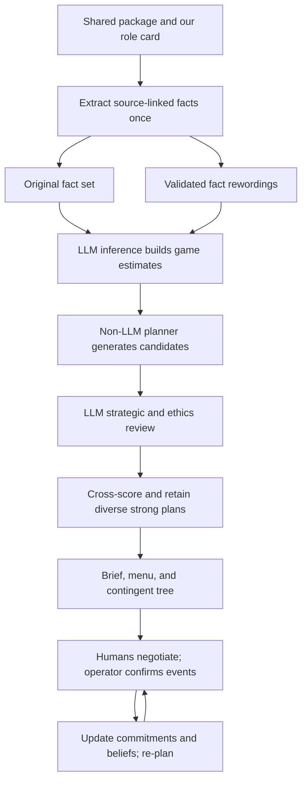

# Negotiation Advisor: Plan A

Rewording robustness, strategy exploration, and support for human-to-human negotiation

A multi-agent system that helps a human team prepare for a **turn-based,
two-team, non-zero-sum negotiation** in humanitarian-crisis settings, and a
study of how **rewording the negotiation package** (same facts, different
words) changes the strategies the system suggests.

> **Status:** planning complete, implementation starting (Week 1 of 8, from
> 2026-10-20). COMPSCI 2822R final project. Owner: Vedant Sandhu.
>

---

## Contents

1. [The idea in one minute](#1-the-idea-in-one-minute)
2. [Research question and hypotheses](#2-research-question-and-hypotheses)
3. [Scope and assumptions](#3-scope-and-assumptions)
4. [Formal model](#4-formal-model)
5. [From package to game](#5-from-package-to-game)
6. [Rewording engine](#6-rewording-engine)
7. [System components](#7-system-components)
8. [Formal results](#8-formal-results)
9. [Evaluation](#9-evaluation)
10. [Train, validate, test](#10-train-validate-test)
11. [Repository layout and setup](#11-repository-layout-and-setup)
12. [Timeline](#12-timeline)
13. [Risks](#13-risks)
14. [What Plan A can and cannot claim](#14-what-plan-a-can-and-cannot-claim)
15. [After Plan A: Plan B](#15-after-plan-a-plan-b)
16. [Open decisions](#16-open-decisions)
17. [References](#17-references)
18. [Human-to-human classroom workflow](#18-human-to-human-classroom-workflow)
19. [Proposed innovations](#19-proposed-innovations)
20. [Implementation contracts and priorities](#20-implementation-contracts-and-priorities)
21. [Classroom evaluation](#21-classroom-evaluation)
22. [Research grounding and claim boundaries](#22-research-grounding-and-claim-boundaries)
23. [Creativity and innovative negotiation strategies](#23-creativity-and-innovative-negotiation-strategies)
24. [Quality-diversity strategy search](#24-quality-diversity-strategy-search)

---


## Design decisions

| Design choice | Confirmed approach |
|---|---|
| Interface | Supports both preparation and live human-to-human negotiation. |
| Perturbation timing | Preparation only; no live rewording loop. |
| Commitments | Adopt Benac’s binding, additive commitment model: accepted commitments enter C and cannot be withdrawn. Operator corrections repair the log, not the agreement. |
| Utility estimates | Produced by the inference engine from the available package and our role card. Both our utilities and the opponent’s utilities are estimates unless explicitly supplied as scores. |
| Perturbation unit | Individual extracted facts first, preserving their meaning and source mappings. Whole-document rewriting is a possible extension, not part of the initial experiment. |
| Primary research question | Does rewording-based aggregation reduce decision-quality loss compared with repeated readings of identical text at equal compute? |
| Secondary research goal | Does it discover more creative, feasible, high-quality strategies than the same-text baseline? |
| Live computation | Confirmed events update commitments and opponent beliefs; the planner produces the next-move card. No LLM is required for live action selection. |

Primary quality evaluation uses scored generated games and regret against an information-matched reference policy. Classroom use provides complementary evidence about utility, workload, and applicability. Count rewording generation and validation in the equal-compute budget. Course permission for live use remains an operational check, not an unresolved product-scope decision.

## 1. The idea in one minute

Both teams get the same shared package plus their own private role card. We
play one side and want the best outcome for our side. We do not assume the
other side has to lose for us to win.

The system works in three layers:

1. **LLMs turn text into a game.** The package is converted into a
   *commitment game* in the style of Benac et al. (2026): the actions each side
   can commit to, the goals those actions satisfy, and a goal-utility matrix
   `G` that says how much each side values each goal. The inference engine estimates our column of `G` from our role card and relevant package evidence; qualitative priorities are not automatically numerical ground truth. The opponent's column is **estimated**, because we only
   partly know what they value.
2. **A non-LLM planner solves the game.** It computes which commitments to
   trade, in what order over the turns, and when to walk away.
3. **LLM advisors check and explain the plan.** A strategic advisor reviews it
   for things the game leaves out, an ethics advisor can flag or veto moves,
   and the result is written up as a one-page brief with a short menu of
   options.

**The perturbation we study is rewording only.** We say the same facts in
different words. The meaning does not change, so the underlying game and the set of optimal plans should remain unchanged under the chosen formalization. **A change in advice is a sensitivity signal, not automatically an error.** Multiple offers can be equally good, ties can be broken differently, and repeated LLM calls can vary even on identical input. Our target is preservation of strategically relevant meaning, constraints, and decision quality. Invariance testing can detect inconsistency without a gold game, but establishing which answer is correct or whether quality improves requires additional evidence.

**The readings also generate strategies.** Each accepted fact rewording may yield a different inferred game. The `K` readings are alternative estimates of the same negotiation. We:

- Pool each reading’s best plan and retain candidates that score well across all readings, checking average and worst-case scores.
- Build a **contingent strategy** when competing opponent models justify one: a probing opening, followed by branches based on observed acceptance or rejection. Clarification questions are an optional extension (§19.3).
- Maintain strategically distinct, high-quality alternatives in a quality-diversity archive (§24).

Variation across readings supplies hypotheses; its frequencies are not automatically calibrated probabilities of actual opponent types.

This adds strategies without adding information, so it stays within the
rewording-only scope.

> **Why rewording first?** It fits the approximately eight-week scope and isolates representation sensitivity. No gold labels are needed to detect inconsistency, while evaluating correctness or quality requires additional evidence. Fact-changing counterfactuals belong to Plan B (§15).



---

## 2. Research question and hypotheses

**Primary question:** Does rewording-based aggregation reduce decision-quality loss compared with repeated readings of identical text at equal compute?

**Secondary question on creativity:** Does the same process discover a broader set of feasible, strategically distinct, high-quality negotiation plans, rather than simply different wordings of the same offer?

The questions below decompose these goals for analysis.

> **When a package's facts are reworded without changing their meaning,**
> **(a)** how much do the suggested strategies change, at which pipeline stage
> does the change enter, and does it track the embedding-space distance
> between the original and reworded facts?
> **(b)** Does aggregating over rewordings produce better and more stable
> strategies than a single reading at equal compute, and better than simply
> resampling the same text?
> **(c)** Does pooling plans across rewordings give a larger menu of robust,
> near-optimal strategies, including contingent ones, than resampling or
> sampling the opponent's values directly?

| ID | Hypothesis | Rationale |
|---|---|---|
| H1: Brittleness exists | A single-reading pipeline changes plans under valid rewordings at a non-trivial rate. | Meaning-preserving changes can affect LLM behavior. |
| H2: Wording versus noise | At matched embedding distance, compare sensitivity to valid rewordings and random surface noise. The proposed hypothesis is comparable sensitivity. | Tests surface-form sensitivity; unvalidated noise is a secondary stress test, not a semantic control. |
| H3: Where it enters | Most material plan changes arise from opponent-utility inference near acceptance thresholds. | Small errors can flip predicted acceptance. Own-utility error bounds alone do not establish this empirical hypothesis. |
| H4: Aggregation helps | Rewording × K lowers regret and instability versus a single reading and same-text resampling × K. | Aggregation can reduce variance; the utility benefit must be measured. |
| H5: The planner helps | The planner pipeline is less brittle than an LLM-only advisor. | A deterministic planner isolates wording effects to its inferred inputs; downstream advisor changes are measured separately. |
| H6: A better menu | Rewording produces more distinct near-optimal plans than same-text resampling (B2) or direct opponent-utility sampling (B9), without reducing true utility. Contingent plans can outperform a fixed plan when responses are informative. | Different readings can expose overlooked structures and trades; cross-scoring screens candidates before independent evaluation. |

The evaluation distinguishes a rewording-specific benefit from a benefit explained by repeated sampling alone.

---

## 3. Scope and assumptions

### 3.1 Non-zero-sum **[ASSUMPTION]**
The two teams' payoffs do not add up to a constant: some outcomes are better
or worse for both. Our objective is **our own utility**. Joint value is
tracked as a secondary metric.

**[DECIDE]** Should we also assume a positive zone of agreement, i.e. some
outcome `C` that both sides prefer to no deal?

### 3.2 What counts as a rewording
A rewording changes the words, not the meaning. The initial experiment acts on individual extracted facts after atomization and before game construction.

| Operator | Unit | Scope |
|---|---|---|
| `paraphrase_fact` | One atomic fact | Initial experiment: wording changes, meaning and provenance preserved. |
| `register_fact` | One atomic fact | Optional audited operator: formal or plain expression with unchanged modality and content. |
| `paraphrase_doc` | Source document | Deferred extension. |
| `reorder` | Documents or facts | Deferred extension. |

**Excluded**, because they change content rather than wording:
- inserting distractor facts or dropping facts;
- gain/loss reframing strong enough to fail the entailment test;
- every counterfactual shift (that is Plan B).

A rewording is **accepted** only if all three checks pass:
1. cosine similarity to the original is at least `τ`;
2. NLI entailment holds in **both** directions;
3. hard facts (numbers, names, red lines) are unchanged.

Audit an initial fixed sample per operator and severity band, then a stratified 5% sample of accepted rewordings, with a minimum sample size fixed during the pilot. Report counts, disagreement, and uncertainty intervals; 5% alone may be too small. Preserve attribution, modality, negation, dates, temporal order, uncertainty, conditions, and red lines, not just names and numbers. Automated acceptance is a screening decision, not proof of semantic equivalence.

### 3.3 Game model, adopted from Benac et al. (2026)
Our professor's benchmark defines the game we use. We keep most of its
assumptions and change two.

| # | Benac assumption | Our use | Why |
|---|---|---|---|
| A1 | Binding commitments; they can be added, never withdrawn | **Adopted** | Matches how deals are built up in the exercise. |
| A2 | Goals need specific commitments; `G` gives each player's value per goal; goals are linear or all-or-nothing | **Adopted**; `G` is built from text (§5) | Gives us an exact, scoreable objective. |
| A3 | Bilateral turns: propose, then accept or reject | **Adopted**; proposer alternates. Non-players (mayor, militia, NGOs) enter as goals or constraints | The exercise is two teams taking turns. |
| A4 | Everyone knows everyone's utilities | **Relaxed**: `G_us` inferred from our role card; `G_opp` estimated as a distribution `π(G_opp)` | Each team has a private role card, so we only partly know the opponent. |
| A5 | Agents are planners or RL methods | **Hybrid**: the planner optimises; LLMs build the game, review and explain | In Benac et al., simple planners beat learned RL policies; LLMs are needed to read the text. |

---

## 4. Formal model

**Package.** `P = (D, R_us)`: the shared documents `D` and our private role
card `R_us`.

**Rewording set.** `[P]` is the set of all accepted rewordings of `P` (§3.2).
`ν` is the sampling distribution over `[P]` induced by our operators.

**Assumption M (meaning is preserved).** Every `P′ ∈ [P]` describes the same
true game `𝔊* = (A, goals, 𝒞, types, G*)`. This holds only as well as the
acceptance filter does. If it fails, observed sensitivity mixes true invariance failures with legitimate responses to changed meaning. Without additional assumptions it is not a guaranteed upper bound. Report audited-valid and all-screened results separately.

**Game** (Benac form, two players):

- **Commitment state** `C ∈ {0,1}^(|A_us| + |A_opp|)`. It starts at `C⁰ = 0`
  (no deal), and entries only go from 0 to 1.
- **Goal satisfaction.** Each goal `g` requires a set of commitments `𝒞_g`.

```math
S_g(C) = \frac{|\mathcal{C}_g \cap C|}{|\mathcal{C}_g|} \;\; \text{(linear)}, \qquad
S_g(C) = \mathbf{1}[\mathcal{C}_g \subseteq C] \;\; \text{(all-or-nothing)}
```

  Both are non-decreasing in `C`.
- **Rewards.**

```math
r_i(C) = \sum_g G_{g,i}\, S_g(C)
```

- **Protocol.** `T` turns; the proposer alternates; at most `k` new
  commitments per side per offer; the responder accepts or rejects; either
  side may walk away.
- **Acceptance model (baseline, not a behavioral law).** The modeled opponent accepts a move `C → C′` if and only if
  its estimated value does not fall (the incentive-compatibility constraint of
  Zhu et al. 2025):

```math
\sum_g \hat G_{g,\mathrm{opp}}\, \Delta S_g \;\ge\; 0, \qquad \Delta S_g = S_g(C') - S_g(C)
```

**The pipeline as a map.**
- `Ĝ(P′)` is the game built from text `P′`.
- `σ(Ĝ)` is the planner's output, which is deterministic.
- `adv(P′, Ĝ, σ)` is the advisors' output, which is stochastic.

**Plan** `σ`: ordered offers, expected responses, fall-backs, a walk-away
point, ethics flags, and a margin for each offer (Prop. A4).

**Objective.** The plan is scored on the **true** game, normalised to `[0, 1]`:

```math
U(\sigma) = r_{\mathrm{us}}(\sigma;\, \mathfrak{G}^*)
```

**Sensitivity** is dependence of the structured output on the accepted wording. **Harmful brittleness** is a wording-induced change in constraints, unsupported content, or decision quality beyond same-text stochastic variation. Report action differences and utility differences separately, with an equivalence tolerance for near-tied plans.

**Cross-reading score.** When the true game is unknown, a plan is scored on
every reading's game. The worst case `min_k r_us(σ; Ĝ_k)` is reported
alongside it.

```math
\bar U(\sigma) = \frac{1}{K}\sum_{k=1}^{K} r_{\mathrm{us}}(\sigma;\, \hat G_k)
```

On generated games we *select* with `Ū` and *report* the true `U`.

**Opponent types from readings.** After aligning game structure, cluster the `K` estimates `Ĝ_opp,k` into
`m ≤ 3` candidate models `θ_1..θ_m`. Cluster shares describe model-output frequency, not validated probabilities that a human opponent has that type. Use them only as an experimental prior, compare with uniform weights, and calibrate on held-out scored games where possible. The role-card uncertainty remains even if every reading agrees. A **contingent strategy** `τ` is a short decision tree: an
opening offer, then one branch per response, each branch planned for the
types consistent with that response. Its value is:

```math
V(\tau) = \sum_{j=1}^{m} w_j\, r_{\mathrm{us}}(\tau;\, \theta_j)
```

---

## 5. From package to game

| Step | Input → output | Notes |
|---|---|---|
| 0 Ingest | PDF/docx → items with verified quotes | reuse `../pipeline/` |
| 1 Atomise | items → facts `F`, each with quote, type and relevance | new |
| 2 Players | `us`, `opp`; everyone else → stakeholders | stakeholders become goals or constraints |
| 3 Actions | `F` → `A_us`, `A_opp` | concrete commitments with owner and quote; about 8 or fewer per side |
| 4 Goals | `F` → goals with `𝒞_g` and type | costs become goals with negative value |
| 5 `G_us` | role card → our column | repeated elicitation, take the median |
| 6 `π(G_opp)` | shared docs + role-card statements → distribution | spread comes from repeated elicitation |
| 7 BATNA | `r(C⁰)` + outside options | |
| 8 Checks | Benac stability metrics, human check, round trip on generated games | |

**Where rewording enters (confirmed).** After atomization and before game construction: individual extracted facts are reworded. Keep the original fact set as the control. Whole-package rewording is deferred. This isolates the effect of fact representation on downstream modeling; it does not measure wording sensitivity of the initial package-to-fact extraction stage.

### Worked sketch: Simulation 2 (we are the Camp Commander, the opponent is FWB)

*The numbers are illustrative, not the real role-card values.*

**Actions.**
- Camp Commander: `a1` independent FWB distribution staff · `a2` FWB hires
  local labourers · `a3` stop giving refugee rations to guards · `a4`
  MASHA/monitor access · `a5` guard conduct code + complaint channel.
- FWB: `b1` ongoing food deliveries · `b2` separate ration / cash-for-work for
  guards · `b3` fuel and sanitation support · `b4` joint distribution with the
  Commander's office · `b5` no public criticism while the deal holds.

| Goal | `𝒞_g` (type) | G_us | G_opp |
|---|---|---|---|
| g1 Refugees adequately fed | {b1, a3} (all-or-nothing) | 2 | 10 |
| g2 Guards fed and loyal | {b2} | 9 | −1 |
| g3 Commander visibly in charge | {b4} | 6 | −1 |
| g4 Independent outsiders in camp | {a1, a2} (linear) | −5 | 4 |
| g5 No unrest / international incident | {b1, b2, a5} (linear) | 7 | 5 |
| g6 Aid independent, not diverted | {a1, a3, a4} (linear) | −3 | 9 |
| g7 Camp infrastructure works | {b3} | 5 | 0 |
| g8 FWB spends beyond food mandate | {b2, b3} (linear) | 0 | −3 |

With 10 binary actions there are 1,024 commitment states. This makes small-state dynamic programming plausible, but does not establish a runtime bound: the search also depends on legal offers, remaining turns, opponent hypotheses, and contingent branching. Benchmark it before claiming millisecond latency. The
trade-off table surfaces the logroll `b2 ↔ a3`: the guards are fed
separately, and the diversion of refugee food ends. This is exactly the kind
of non-zero-sum trade the system is meant to find.

---

## 6. Rewording engine

1. Embed every extracted fact with one open sentence encoder
   (MTEB-class).
2. Generate `K` rewordings per unit with an LLM, asking for several
   "distances" (light, moderate, heavy) so that the embedding distance
   `d_emb` covers a range.
3. Accept or reject each one using the checks in §3.2, and log rejection
   rates per operator.
4. Record `d_emb(P, P′)`, the cosine distance averaged over changed units.
5. **Random-noise control (for H2).** Character- and word-level noise at
   matched `d_emb` that is *not* checked for meaning. This separates "the
   system reacts to wording" from "the system reacts to any surface change".

---

## 7. System components

| Component | Type | Job |
|---|---|---|
| Extractor + atomiser | LLM | §5 steps 0-1: package → atomic facts with source quotes. |
| Rewording engine | LLM + embeddings | §6: produce and filter rewordings. |
| Game builder | LLM | §5 steps 2-8: facts → actions, goals, `G_us`, `π(G_opp)`, BATNA. |
| Planner | non-LLM | Exact search over commitment sequences for small games; MCTS with Benac value estimates for larger ones. Outputs the plan, the trade-off table, and the margin of every offer (Prop. A4). |
| Strategic advisor | LLM | Reviews the plan for things `G` leaves out (relationships, reputation, context). Writes the brief. |
| Ethics advisor | LLM | Flags moves against humanitarian principles and do-no-harm; can veto. |
| Aggregator + quality-diversity archive | non-LLM | Cross-scores candidates, retains high-quality plans across strategic niches, and selects the strategy menu (§24). |
| Opponent simulators + executor | planner and LLM | Planner opponents and LLM opponents from at least 2 model families play the plan turn by turn, for scoring. |
| Judge | code, then LLM | Scores programmatically from the true `G` where we have it. For unscored packs, an LLM judge from a different model family than the advisors, run with the order swapped and calibrated against human ratings. |

**How the aggregator builds the strategy menu.**

1. **Averaged game.** Average `Ĝ` over rewordings (when their structure
   matches after canonical alignment), then plan once. Do not average utilities across different goal identities, scales, or action meanings. This plan is always a candidate.
2. **Pool.** Add each reading's own best plan `σ_k`.
3. **Structural alternatives.** Where readings disagree on the actions or on
   what a goal requires, plan on each version. Label the plan with the
   ambiguous passage, e.g. *"if 'joint distribution' means co-signing
   manifests rather than co-staffing, a cheaper deal exists."*
4. **Contingent strategy.** If the readings' `Ĝ_opp` split into more than one
   opponent type (§4), the planner builds the decision tree `τ`: a probing
   opening offer whose accept or reject tells us which type we face, then
   the best plan for that type.
5. **Advisor ideas.** Advisors reading different rewordings propose extra
   options (sequencing, packaging, side guarantees). A new action is
   accepted only with a quote from the package. It then goes back through
   the game builder and is scored by the planner. Ideas that need new facts
   belong to Plan B.
6. **Re-score.** Score every candidate on every reading (`Ū` and worst
   case). Drop candidates that only win on their own reading.
7. **Menu.** Retain the strongest candidate in each occupied strategic niche using the quality-diversity archive (§24). Choose 3-5 distinct candidates that meet an additive quality threshold relative to the best independently scored candidate. Add the contingent tree if its tested score justifies it.
8. **Fresh re-scoring.** Recompute the menu's scores on a fresh set of
   rewordings and episodes before showing or reporting them (Prop. A5).

Each plan gets separate labels for observed agreement across sampled readings, conditional numerical stability, and source support. Agreement across K samples is not a certificate for every paraphrase or for actual human acceptance. Corollary A4′ requires the qualifications below.

> **Why a menu and not one answer?** Frontline humanitarian negotiators
> said they want tools that help them explore options and their risks, not
> tools that tell them what to do (Ma et al. 2024, 2025).

---

## 8. Formal results

Notation: `ν` is the distribution over rewordings `[P]`; `Ĝ(P′)` is the game
built from rewording `P′`; `G*` is the true matrix; `U ∈ [0, 1]`.

The results assume consistent utility normalization and the conditions stated below. Bounds on matrix error do not automatically imply bounds on closed-loop negotiation utility.

### Prop. A1: rewording spread lower-bounds extraction error

```math
\mathbb{E}_\nu \lVert \hat G(P') - G^* \rVert^2
= \lVert \mathbb{E}_\nu \hat G - G^* \rVert^2 + \mathbb{E}_\nu \lVert \hat G - \mathbb{E}_\nu \hat G \rVert^2
\;\ge\; \mathbb{E}_\nu \lVert \hat G - \mathbb{E}_\nu \hat G \rVert^2
```

*Proof.* Expand around `E_ν Ĝ`; the cross term has expectation zero. ∎

**Use.** With fixed, aligned matrix coordinates and a fixed latent `G*`, population variance lower-bounds population expected squared matrix error. Empirical sample variance is an estimate, not a guaranteed finite-sample lower bound without uncertainty analysis. Structural mismatches require separate analysis; this result does not certify accuracy or utility.

### Prop. A2: when aggregating over rewordings helps

Let `Ḡ_K = (1/K) Σ_k Ĝ(P′_k)`. If per-entry errors have common variance `s²`
and pairwise correlation `ρ`, then, per entry and summed over entries:

```math
\mathbb{E}\lVert \bar G_K - G^* \rVert^2 = \lVert \text{bias} \rVert^2 + s^2 \left(\rho + \frac{1-\rho}{K}\right)
```

*Proof.* The variance of the mean of `K` equicorrelated variables is
`(1/K²)(K s² + K(K−1) ρ s²)`. ∎

**Use.** Aggregation removes wording variance, not bias. With equal `K` and
equal bias, and under equal bias and equal marginal variance, averaging rewordings has smaller mean-squared matrix error when `ρ_reword < ρ_resample`. This is not an if-and-only-if statement about negotiation utility or regret: planning is nonlinear and acceptance can be discontinuous. This is the exact form of H4, and `ρ` is estimated
from data.

### Prop. A3: errors in our own column have bounded cost

For every state `C`:

```math
\lvert r_{\mathrm{us}}(C; G_{\mathrm{us}}) - r_{\mathrm{us}}(C; G'_{\mathrm{us}}) \rvert \le \lVert G_{\mathrm{us}} - G'_{\mathrm{us}} \rVert_1 =: \varepsilon
```

*Proof.* `S_g ∈ [0, 1]` and the triangle inequality. ∎

*Corollary.* If the set of plans the opponent is predicted to accept is the
same under both columns, the plan chosen under `G′_us` loses at most `2ε` on
the true values:
`r(σ′) ≥ r′(σ′) − ε ≥ r′(σ*) − ε ≥ r(σ*) − 2ε`. ∎

**Use.** Small own-value errors have bounded loss under a fixed structure and feasible set. This does not establish that own-value extraction is accurate or unimportant. Opponent-model errors can additionally change predicted acceptance (Prop. A4).

### Prop. A4: acceptance margin

For an offer `C → C′` with margin `m = Σ_g G_{g,opp} ΔS_g > 0`, the
acceptance decision is unchanged for every error `δ` in the opponent's column
with

```math
\lVert \delta \rVert_1 < \frac{m}{\lVert \Delta S \rVert_\infty}
```

and the bound is tight.

*Proof.* By Hölder, `|δ · ΔS| ≤ ‖δ‖₁ ‖ΔS‖_∞`. For tightness, put all of `δ`
on `argmax_g |ΔS_g|` with the opposite sign. ∎

### Corollary A4′: conditional plan stability result

For a rewording, let `ε_us = ‖ΔĜ_us‖₁`, `ε_opp = ‖ΔĜ_opp‖₁`, and let `m_min`
be the smallest value of `|m| / ‖ΔS‖_∞` over all relevant reachable offers, accepted and rejected, with nonzero `ΔS`. If any relevant margin is zero, no strictly positive radius is certified. If

1. the goals and actions are unchanged,
2. `ε_opp < m_min`, and
3. the chosen plan beats the runner-up by more than `2 ε_us`,

then the planner returns the same plan **provided** the feasible-plan set is unchanged, tie-breaking is deterministic, and opponent response depends only on the tested acceptance inequalities. For these inequalities use the minimum **absolute** margin over all relevant reachable offers, including rejected offers; zero margins are uncertifiable. If the opponent policy selects among counteroffers or considers continuation values, those decision boundaries must also be preserved. A positive-margin-only check does not certify an entire adaptive plan.

*Proof sketch under the qualified model.* Applying the absolute-margin bound to every relevant offer preserves its acceptance classification. With a fixed feasible-plan set and deterministic tie-breaking, A3 and a strict score gap preserve the maximizing plan. Additional response-policy boundaries require their own checks. ∎

**Use.** A conditional, checkable statement about stability inside the specified numerical game model. Show its assumptions in the brief; do not label it a guarantee of real-world acceptance.
**Limit.** It says nothing when a rewording changes the game's *structure*
(new or missing goals or actions). Structure stability is measured separately
with the Benac metrics.

### Prop. A5: winner's curse

With noisy scores `Ŝ_i = S_i + ε_i`, where `ε_i` is σ-sub-Gaussian, over `N`
candidates and `î = argmax Ŝ_i`:

```math
\mathbb{E}\big[\hat S_{\hat\imath} - S_{\hat\imath}\big] \le \sigma\sqrt{2\ln N}
```

**Use.** Picking the best of many noisy candidates inflates its score. Any
selected plan is re-scored on fresh episodes before we report it.

### Prop. A6: sample size

For scores in `[0, 1]`, evaluating each strategy on

```math
n \ge \frac{2\ln(4/\delta)}{\Delta^2}
```

episodes separates a true gap `Δ` with probability `1 − δ` (Hoeffding plus a
union bound). For `Δ = 0.1` and `δ = 0.05`, `n ≈ 876`. Pairing can improve power when it reduces variance; the gain must be estimated rather than assumed.

### Remark A7: pooling and contingency never lower the selection score

- The pool contains the single-reading and averaged-game plans, so the best
  `Ū` in the pool is at least as high as theirs.
- A plan that ignores the opponent's response is a contingent tree whose
  branches are identical, so the best tree's `V` is at least the best plan's.

**Use and limit.** Both statements are about scores on *estimated* games,
and a larger pool increases the winner's-curse bias (A5 with a larger `N`).
So we claim a gain only after fresh re-scoring, and only on the true `U` of
generated games.

### Measure (not a theorem): embedding effect

```math
\hat L = \max_{P'} \frac{D(\sigma(P), \sigma(P'))}{d_{\mathrm{emb}}(P, P')}, \qquad \operatorname{corr}(D,\, d_{\mathrm{emb}})
```

`D` is the distance between strategies. For strategically equivalent outputs, the semantic discrepancy target is zero. Exact plan identity is not required when alternatives are tied or equivalent. Exclude near-zero denominators using a predeclared threshold; this finite-sample maximum is not a global Lipschitz certificate. We report this
separately for each stage: game, plan and advisor.

---

## 9. Evaluation

### 9.1 Studies
- **S1 Brittleness by stage.** For each pack or game and `K` rewordings,
  measure the change at each stage:
  - game structure (Benac similarity);
  - `G` entries (L1 distance);
  - plan (structured diff);
  - advisor output (archetype flip, rationale distance).

  An advisor-only variant fixes `Ĝ` and rewords only the advisor's fact input. Initial extraction is held fixed in the main experiment; whole-document extraction sensitivity is a separate extension.
- **S2 Embedding effect.** Curves of `D` against `d_emb`, the estimate `L̂`,
  and rewording versus the random-noise control at matched `d_emb`.
- **S3 Aggregation.** Regret on generated games, where the true `G` is known,
  for three conditions: a single reading, same-text resampling × K, and
  rewording × K. Estimate `ρ` (Prop. A2).
- **S4 Certificate validity.** How often Corollary A4′ holds, and whether
  certified plans really are stable on fresh rewordings.
- **S5 Strategy menu.** On generated games, compare rewording × K with B2
  and B9 at equal compute:
  - the number of distinct plans with true `U ≥ α · U*`;
  - their coverage of the Pareto-efficient deals;
  - the true `U` of the best menu item and of the contingent tree.

### 9.2 Baselines (all matched on compute)

| ID | Condition |
|---|---|
| B0 | Single LLM, zero-shot strategy |
| B1 | B0 + chain-of-thought |
| B2 | Same-text resampling × K, aggregated (**main control**) |
| B3 | Multi-agent, single reading |
| B4 | Random-noise perturbation × K at matched `d_emb` |
| B7 | Planner on a single-reading `Ĝ`, no LLM advisors |
| B8 | LLM advisors only, no planner |
| B9 | Planner over `K` samples of `G_opp` drawn from the single-reading `π(G_opp)`, with the same pooling and contingent tree; no rewording (**hardest control**) |
| **A** | Rewording × K + planner + advisors + aggregator |

> **Why B9 matters.** If rewording helps only because it widens our estimate
> of the opponent's values, then sampling those values directly should do
> just as well. Rewording earns credit for H4 and H6 only if it beats B9,
> for example by also catching misread game structure.

B5 and B6 are reserved for fact-changing experiments in Plan B.

### 9.3 Metrics
- **Stability:** plan-change rate; archetype flip rate; `L̂`; L1 distance in
  `G`; Benac goal and action similarity; certificate coverage; ethics-flag
  stability.
- **Outcomes:** our utility and regret on generated games; agreement rate;
  accepted agreements below BATNA, with partial-commitment and outside-option semantics explicitly defined (target: 0).
- **Menu:** number of distinct plans within `α` of the best; coverage of
  Pareto-efficient deals; gain of the contingent tree over the best single
  plan.

### 9.4 Statistics
- Paired designs.
- Mixed-effects models: condition as a fixed effect; pack and opponent as
  random effects.
- Bootstrap 95% confidence intervals.
- Holm-Bonferroni correction across hypotheses.
- At least 3 seeds.

---

## 10. Train, validate, test

The live course negotiation is the **test**. Everything before it happens
offline with no time limit.

| Split | Data | Time limit |
|---|---|---|
| Train | Generated Benac games rendered as text; Simulation 1 | none |
| Validate | Held-out generated games; Simulation 2 | none |
| Test | Live exercise package, unseen | 12 min prep (brief within 6 min), then 12-15 min negotiation |

**Frozen before the test:**
- the rewording operators and thresholds;
- the game builder prompts;
- the aggregation rule and `K`;
- the menu settings (`α`, number of opponent types `m`, tree depth);
- the advisor and ethics prompts.

Nothing is tuned on the test package. The live result is reported as a case
study, separately from the validation numbers.

---

## 11. Repository layout and setup

> Planned layout; folders are created as the timeline (§12) reaches them.

```
Final Build/
├── README.md                  ← this plan
├── PLAN_A_REWORDING.md        ← compact working copy of Plan A
├── PLAN_B_COUNTERFACTUAL.md   ← the follow-on plan (§15)
├── PLAN_COMPARISON.md         ← effort and burden-of-proof comparison
├── PROJECT_PLAN.md            ← project model and background
├── requirements.txt
├── .env.example               ← API keys (never commit .env)
├── configs/
│   ├── default.yaml           ← models, budgets, seeds, thresholds
│   └── experiments/*.yaml     ← one file per baseline / study
├── data/
│   ├── packs/                 ← course packs (Simulation 1, Simulation 2)
│   ├── gold/                  ← human annotations
│   └── scored_games/          ← games with true G (hidden from advisors)
├── negotiator/
│   ├── schemas.py             ← Fact, Game, Plan, Transcript, Score
│   ├── llm.py                 ← provider-agnostic client + prompt-hash cache
│   ├── extract/               ← wraps ../pipeline + atomiser
│   ├── reword/                ← embedder, operators, acceptance filter, noise control
│   ├── game/                  ← commitment game, text→game builder, game→text renderer
│   ├── planner/               ← exact search, MCTS, trade-off table, margins, certificate, contingent tree
│   ├── agents/                ← advisors, ethics, opponents, executor, judge, aggregator
│   ├── eval/                  ← metrics, statistics
│   └── prompts/               ← all prompts as .md files
├── scripts/                   ← command-line entry points
├── runs/                      ← outputs, one folder per run (gitignored)
└── tests/
```

**Setup (once code exists):**

```bash
cd "Final Build"
python3 -m venv .venv && source .venv/bin/activate
pip install -r requirements.txt
cp .env.example .env    # add ANTHROPIC_API_KEY and a key for the judge's provider
```

**Planned commands:**

```bash
python scripts/extract.py  --pack data/packs/sim2 --side "Camp Commander"
python scripts/reword.py   --facts runs/<id>/facts.json --k 16
python scripts/advise.py   --config configs/experiments/a.yaml
python scripts/evaluate.py --runs runs/<id1> runs/<id2> --report
```

---

## 12. Timeline

About 8 weeks from 2026-10-20. Each week ends with a check that must pass
before moving on.

| Week | Deliverable | Check |
|---|---|---|
| 1 | Repo skeleton, schemas, LLM client + cache, extractor + atomiser | Simulations 1 and 2 extract end to end; quotes 100% verified |
| 2 | Game builder; Simulation 2 game; Benac generator + game→text renderer | A rendered package round-trips to the same `G` |
| 3 | Planner (exact) + trade-off table + margins; rewording engine + filter | At least 95% of accepted rewordings judged meaning-preserving by a human |
| 4 | Advisors, aggregator with pooling + contingent tree, opponents, judge | A full episode runs end to end; the contingent tree matches brute force on a small game |
| 5 | Studies S1 + S2 | Brittleness-by-stage table; `D` vs `d_emb` plots |
| 6 | Studies S3 + S4 + S5 | Aggregation vs resampling with CIs; certificate coverage; menu vs B2 and B9 |
| 7 | Freeze + exercise pipeline (brief within 6 min) | 10 out of 10 timed dry runs succeed |
| 8 | Write-up | Headline numbers reproduce |

---

## 13. Risks

| Risk | Mitigation |
|---|---|
| Rewordings secretly change meaning (Assumption M fails) | Two-way NLI + frozen hard facts + 5% human check; report brittleness as an upper bound |
| Rewording changes the game's *structure* (new or missing goals) | Report structure stability separately; A4′ applies only when structure matches |
| Aggregation helps only as much as resampling | That is a valid finding (H4 false); report it |
| A larger candidate pool inflates scores (winner's curse) | Select on `Ū`; report on fresh rewordings and episodes, and on true `U` (A5, A7) |
| The probing offer is binding and costs value | The planner prices it in: the tree is used only if `V(τ)` beats the best single plan |
| Judge bias | Programmatic scoring on generated games; judge from a different model family |
| Cost | Prompt-hash cache; small-`K` pilots first |

---

## 14. What Plan A can and cannot claim

**Can:**
- quantify wording brittleness at each stage of the pipeline;
- give a conditional stability result in aligned `G` space under a specified opponent-response model;
- show whether aggregating over rewordings beats resampling;
- produce a larger menu of robust plans, including contingent strategies, for
  the package as written.

**Cannot:**
- say whether the advice responds *correctly* when facts really change;
- discover strategies for situations that are not in the package.

New plans in Plan A come from searching across readings, not from new
information. Strategies for changed facts are Plan B.

---

## 15. After Plan A: Plan B

`PLAN_B_COUNTERFACTUAL.md` extends this work to perturbations that change
the facts by a controlled amount (for example, the opponent's BATNA gets
stronger), where the *right* answer is a specific change in the plan.
Everything in Plan A is reused:
- the rewording engine becomes Plan B's wording control;
- Props. A3-A4 become Plan B's bounded/unbounded-column result.

The recommended order is to finish Plan A, then add Plan B's provable shifts
first (goal values, BATNAs, number of turns), and only then the parts that
need concept directions, steered decoding or self-play. `PLAN_COMPARISON.md`
gives the effort and burden-of-proof comparison.

---

## 16. Open decisions

- **[DECIDE]** Is a deal preferred over no deal? Modelled as a parameter
  `deal_bonus`; results are reported for `{0, small, large}`.
- **[DECIDE]** Is the package available before prep starts? We assume not.
- **[CONFIRMED]** The interface supports live negotiation as well as prep. **[CHECK]** Confirm course permission before live classroom use.
- **[DECIDE]** Which side do we play in each pack?
- **[DECIDE]** Can we access and run the Benac code? The current arXiv abstract links an anonymous code/data repository; accessibility, license, and local execution remain unverified.
- **[DECIDE]** Do we assume a positive zone of agreement (§3.1)?

---

## 17. References

**Negotiation analysis**
- Fisher, R., & Ury, W. (1981). *Getting to Yes.* Houghton Mifflin.
- Lax, D. A., & Sebenius, J. K. (1986). *The Manager as Negotiator.* Free Press.
- Raiffa, H. (1982). *The Art and Science of Negotiation.* Harvard University Press.

**Game model and planning**
- Benac, Raedler, Ma & Doshi-Velez (2026). *A Benchmark for Multi-Party
  Negotiation Games from Real Negotiation Data.*
  [arXiv:2603.14066](https://arxiv.org/abs/2603.14066). Our primary model and
  benchmark: the commitment game, the generator, the planners (Myopic, Upper
  and Lower value estimates), and the text-to-game pipeline with stability
  metrics (goal similarity 0.791, action similarity 0.960).
- Zhu, Wang, Subramanian & Poupart (2025). *Learning to Negotiate via
  Voluntary Commitment.* AISTATS. Commitment games with an
  incentive-compatibility constraint on proposals, which is the basis for our
  acceptance rule.
- Wu et al. (2024). *Minimally Modifying a Markov Game.* ICML. Finds the
  smallest payoff change that alters the equilibrium. We ask the inverse
  question (the smallest change to `G_opp` that flips an acceptance), which
  gives Prop. A4.


**Robustness of LLM outputs**
- Sclar et al. (2024). *Quantifying Language Models' Sensitivity to Spurious
  Features in Prompt Design.* [arXiv:2310.11324](https://arxiv.org/abs/2310.11324).
- Mizrahi et al. (2024). *State of What Art? A Call for Multi-Prompt LLM
  Evaluation.* TACL.
- Ribeiro et al. (2020). *Beyond Accuracy: Behavioral Testing of NLP Models
  with CheckList.* ACL. [arXiv:2005.04118](https://arxiv.org/abs/2005.04118).
  Plan A is an invariance (INV) study in CheckList's terms.
- Wang et al. (2023). *Self-Consistency Improves Chain of Thought Reasoning
  in Language Models.* ICLR. [arXiv:2203.11171](https://arxiv.org/abs/2203.11171).
  Same-text resampling, our main control (B2).

**Users and judges**
- Ma et al. (2024). [arXiv:2405.20195](https://arxiv.org/abs/2405.20195), and
  Ma et al. (2025). *"ChatGPT, Don't Tell Me What to Do."*
  [arXiv:2410.09139](https://arxiv.org/abs/2410.09139). Frontline negotiators
  prefer option exploration to directives, which is why the output is a menu.
- Zheng et al. (2023). *Judging LLM-as-a-Judge with MT-Bench and Chatbot
  Arena.* [arXiv:2306.05685](https://arxiv.org/abs/2306.05685).
- Panickssery et al. (2024). *LLM Evaluators Recognize and Favor Their Own
  Generations.* [arXiv:2404.13076](https://arxiv.org/abs/2404.13076).


---

## 18. Human-to-human classroom workflow

### 18.1 What the classroom exercise evaluates

The class exercise is a human negotiation supported by the tool. It is not an LLM-versus-LLM episode and not merely a way to collect transcripts. The preparation brief and, if permitted, the live planner should help a human team identify trades, understand uncertainty, and adapt its choices. The team retains authority over every offer and agreement.

There are two distinct evaluations. Offline experiments test wording sensitivity and strategy quality under controlled conditions. The classroom tests whether the system fits an actual team’s preparation and exchange rhythm. One classroom outcome is a case study, not a causal estimate of improvement over an unassisted team.

### 18.2 Phase 1: 12-minute preparation

These are engineering targets to measure in timed rehearsals, not achieved runtimes.

| Clock | Processing and team activity | Required output |
|---|---|---|
| 0:00-1:30 | Ingest shared documents and our role card; extract grounded facts; build one canonical game; run the baseline planner. | A usable fallback brief and trade-off table. If extraction is incomplete, expose the missing sections. |
| 1:30-5:00 | Run a bounded number of reworded readings in parallel; align games; generate and cross-score candidate plans; perform strategic and ethics review. | A small strategy menu, disagreement report, and a shallow contingent tree where justified. |
| 5:00-6:00 | Stop new generation, cancel overrunning work, and assemble the best validated outputs already available. | One-page brief plus a compact operator view. Use deterministic templates if LLM summarization misses the deadline. |
| 6:00-12:00 | Humans read, inspect critical sources, correct material errors, and choose an opening and fallback. | A team-approved plan with explicit red lines and unresolved assumptions. |

Choose K from measured latency and token budgets. Begin pilots with K = 4, compare K = 8 and 16 offline, and freeze the live setting after validation. A half-complete variant must never replace a validated baseline just because its estimated score looks higher. Log every manual correction; human edits can materially affect subsequent results.

The one-page brief contains: the objective and outside option; our red lines; a trade-off table; a recommended opening and two alternatives; a short response tree; three high-impact assumptions with original quotes; and unresolved ethics or feasibility concerns. Keep full equations, ensemble matrices, and search traces in the operator view rather than in the negotiators’ main reading flow.

### 18.3 Phase 2: 12-15-minute human negotiation

One teammate operates the tool; other teammates conduct the negotiation. The minimum build uses structured action buttons and a deterministic shorthand grammar. No LLM is required in the live decision loop. Optional transcription or LLM parsing is a separate input layer: its output is provisional until confirmed and never authorizes a commitment.

| Step | Operator or system action | Safeguard |
|---|---|---|
| 1. Capture | Record who proposed what, whether it was accepted, and any explicit condition. | Distinguish an offer, question, rejection, and tentative agreement. |
| 2. Confirm | Display a readable structured event for operator confirmation. | Preserve the raw note; allow correction and undo. |
| 3. Transition | Apply only the confirmed event to the game state. | Reject impossible action owners, contradictory terms, and unauthorized red-line changes. |
| 4. Update beliefs | Update opponent-model weights from the observed response. | Preserve model uncertainty; one rejection must not eliminate an entire hypothesis. |
| 5. Re-plan | Evaluate legal offers from the current state, remaining time, and response model. | Include a planning timeout and the last valid recommendation. |
| 6. Advise | Show the next offer, fallback, value range, and the assumption that most affects the choice. | Humans decide whether to follow it; record overrides without blocking them. |

The next-move card should answer: What can we offer? What do we gain? What could make this fail? What should we ask or listen for next? Show “acceptance predicted by 3 of 4 current models,” rather than an uncalibrated “75% chance they accept.” A numerical probability is appropriate only when its interpretation and calibration have been established.

Estimate remaining exchanges from observed exchange duration, using a pilot-derived default before enough data exist. Test several horizon estimates. The number of binary commitment states does not determine the cost of searching histories and belief states; measure median and p95 planning time over the largest intended instances.

### 18.4 Belief update and acceptance assumptions

For model θ_j, confirmed response y_t, offer o_t, and history h_t:

```math
w_{j,t+1} = \frac{w_{j,t}\,p(y_t\mid o_t,h_t,\theta_j)}{\sum_\ell w_{\ell,t}\,p(y_t\mid o_t,h_t,\theta_\ell)}.
```

The proposed match/mismatch rule is a simple special case: likelihood 1−β for the predicted response and β otherwise. β is an observation-model parameter, not a known rate of tactical rejection. Select it on development data and test sensitivity; a default such as 0.3 must remain labeled as a heuristic until calibrated.

An incremental-utility threshold is only one response policy. Compare it with a reservation-value policy, a concession-seeking policy, and a noisy utility-sensitive policy. A person may reject a beneficial offer because they expect a better continuation. Predictions should distinguish a counteroffer from an unconditional rejection when the protocol supports that distinction. If all models repeatedly fit poorly, show “opponent outside current model set” rather than forcing confidence into the least-wrong type.

### 18.5 Commitments, outside options, and ethics

The implementation adopts Benac’s binding, additive commitment model. Accepted commitments enter monotone C permanently. Tentative proposals remain outside C until accepted. If actual classroom rules differ, document that mismatch and revise the protocol before the run rather than silently treating tentative offers as binding. An operator undo corrects a logging error; it must not silently imply that an actual human agreement was revoked.

The outside option needs an explicit payoff representation. With the current formula r_i(C)=Σ_g G_gi S_g(C), C=0 gives zero for every player unless a baseline or outside-option term is added. Represent disagreement utility d_i separately, define when it is available after partial commitments, and specify what is scored if time expires. Do not derive a nonzero BATNA from an all-zero empty commitment state.

Encode confirmed role-card red lines as hard constraints. Treat an LLM ethics review as a sourced advisory layer, with explicit human adjudication of ambiguous flags. A hard veto should come from an agreed rule or confirmed constraint, not an unexplained model judgment. Track implications for affected stakeholders as separate outcomes or constraints; do not silently modify the team’s utility function.

### 18.6 Voice and laptop-free use

Voice is optional. Structured entry can support the classroom workflow without an audio subsystem. If voice is added, log transcription uncertainty and confirmation time separately from planning time, and evaluate errors in amounts, action owners, negations, and conditional commitments. Audio changes the input problem; it does not change the location of the Plan A rewording engine, which still acts during preparation.

A printed shallow tree is the fallback if a laptop or live AI use is disallowed. Its branches should use observable events, such as “they insist on independent distribution,” rather than invisible claims such as “they are type θ₂.” Include “none of these branches fit” and a short checklist for returning to sources and red lines.

## 19. Proposed innovations

The following extensions target evidence tracing, uncertainty, information gathering, and robust plan selection.

### 19.1 Trace unstable advice back to evidence

**Idea.** Every action, goal, payoff judgment, and recommended trade carries a dependency path back to an original quote. When advice changes across readings, show the first material divergence: fact extraction, goal requirements, utility estimate, acceptance boundary, or advisor interpretation.

Example: “The opening changes because one reading interprets ‘joint distribution’ as co-staffing and another as co-signing records.” This is more actionable than a generic low-confidence badge. Store paraphrases as derived variants with mappings to the original source; never label generated wording as an original quote.

**Evaluation.** Use generated cases with planted extraction mistakes. Measure localization accuracy and whether humans correct the relevant mistake faster than with a score-only dashboard. Minimum version: source links plus a structured diff; stretch version: intervention-based attribution, replacing one disputed component at a time.

### 19.2 Separate wording disagreement from substantive uncertainty

**Idea.** Use two distinct indicators: “readings disagree” and “opponent preference unknown.” A unanimous model can still be wrong or lack information. Conversely, several models may disagree about wording even when the opponent’s actual preference is fixed.

Compute decision-level disagreement after grouping materially equivalent plans. Inspired by semantic uncertainty, compare entropy over structured strategy classes with raw text variation. This adapts an uncertainty idea to negotiation; it is not a calibrated estimate of real opponent uncertainty.

**Evaluation.** On scored games, compare the indicators with extraction error, utility loss, and acceptance prediction accuracy. Check whether the display reduces overconfidence on unanimously wrong cases.

### 19.3 Ask a clarifying question before making a costly probe

**Idea.** When two plausible interpretations imply different plans, propose a brief question such as “Does joint distribution require your staff at every site, or would jointly signed records meet the requirement?” Distinguish discovering existing information from introducing a new commitment or changing the package.

For small games, estimate the expected downstream value of asking minus its time cost. A binding offer used only to learn preferences can sacrifice value; a clarification question may be cheaper. Its answer can still be misleading, so weight it through the response model rather than treating it as verified truth.

**Evaluation.** Compare a fixed opening, an offer-based probe, and a question-based probe under the same interaction budget. Count questions as time or turns, include evasive answers, and report both our utility and agreement rate. This is a stretch feature, not a prerequisite for the classroom build.

### 19.4 Allocate rewording effort near decision boundaries

**Idea.** After an initial broad sample, spend additional readings on facts attached to small acceptance margins or uncertain goal dependencies. An unstable detail that never changes a feasible action should receive less compute than a detail that changes whether the opening can succeed.

A simple priority score combines observed disagreement, decision impact, and expected processing cost. This is a heuristic until tested; embedding distance alone does not determine strategic importance.

**Evaluation.** Compare uniform K-per-fact sampling with adaptive allocation at equal total calls and tokens. Keep a separate uniform, independently generated holdout set for evaluation so targeted search does not define its own test distribution. Measure harmful failure discovery per call, final regret, and deadline completion.

### 19.5 Choose a fallback with low worst-case regret

**Idea.** Alongside the mean-score winner, include a plan that minimizes maximum estimated regret across aligned readings:

```math
\sigma_{\mathrm{rob}}\in\arg\min_\sigma\max_j\left[\max_{\sigma'}U(\sigma';\hat{\mathcal G}_j)-U(\sigma;\hat{\mathcal G}_j)\right].
```

Only compare utilities on a common within-scenario scale. Label this as robustness to the tested model set, not a guarantee for reality. Show which disputed assumption causes each plan’s worst case and how much estimated upside is sacrificed.

**Evaluation.** Compare mean-score selection, worst-case-score selection, and minimax regret on independently generated games and opponent policies. The class brief can present one preferred plan and one robust fallback without exposing every mathematical detail.

### 19.6 Detect when the conversation exceeds the game model

**Idea.** Include a “new issue / not modeled” control. If the humans introduce a new guarantee, stakeholder, or conditional arrangement, the operator can preserve it without forcing it into an existing action. The interface flags that current recommendations omit this issue.

With the no-LLM live constraint, do not silently rebuild the game from new free text. Let the humans use the brief while the planner clearly reports its limitation; an authorized manual structured update is a later extension. Track these events as model-coverage failures.

**Evaluation.** Plant an unmodeled but relevant offer in a rehearsal. Measure detection, logging accuracy, and whether the team recognizes that displayed values exclude it.

## 20. Implementation contracts and priorities

### 20.1 Shared data contracts

| Object | Minimum fields |
|---|---|
| Source item | source ID, original text, document location, quote offsets, provenance |
| Fact | claim, attribution, uncertainty/modality, time, conditions, protected tokens, source IDs |
| Rewording | parent ID, operator, generated text, encoder/version, distances, filter outputs, audit status |
| Game | canonical action and goal IDs, owners, dependencies, goal types, utility scale, outside options, constraints, assumptions |
| Candidate plan | offers or policy tree, source dependencies, acceptance model, horizon, feasibility checks, scores across models |
| Confirmed event | timestamp, actor, event kind, proposed terms, conditions, confirmation, correction history |
| Run record | configuration hash, model versions, prompt hashes, seeds where supported, call/token cost, stage latency, result status |

Use one canonical ontology for comparing games. Canonicalization is itself fallible: log unresolved matches, missing actions, merged goals, and scale differences. Restrict matrix averaging and numerical certificates to aligned structures; compare structural alternatives explicitly. Use fixed normalization constants within a scenario rather than normalizing each reading by its own extrema.

### 20.2 Core algorithms and operator output

First implement a deterministic small-game solver with memoization over the state, actor, remaining turns, and necessary opponent-model information. A binary state count alone is not a complexity proof. Check the solver against independently enumerated toy cases with known legal offers and terminal values. Use a deterministic tie-break and a numerical tolerance for equivalent plans.

The strategic advisor may propose a grounded overlooked action, but that action must pass the same schema, source, ethics, and feasibility checks before entering the solver. If its review changes the strategic action, record that change as a separate pipeline stage rather than attributing it to the planner.

In the live interface, show a short top card, not an entire search tree. Precompute short explanations from the structured plan during prep; live cards can be template-generated from values and conditions. Keep operator confirmation and negotiator decision separate.

### 20.3 Minimum build versus extensions

| Priority | Deliverable | Exit criterion |
|---|---|---|
| P0 | One package-to-game path, explicit assumptions, deterministic planner, source-linked brief | Team can inspect and correct a complete small case. |
| P0 | Validated rewordings and same-text repeated-run control | Meaning audit and stage-level comparison run end to end. |
| P0 | Timed prep cutoff, printed fallback, structured live event entry | A rehearsal completes without relying on unfinished generation. |
| P1 | Cross-reading alignment, pool and re-score, robust fallback | Selection is evaluated on independent cases rather than its own scores. |
| P1 | Opponent-model update and shallow contingent branches | Scripted responses update beliefs correctly; uncertainty is visible. |
| P2 | One innovation from §19 | Beats a simpler ablation on its specified metric. |
| Deferred | Voice, full PSRO, weight training, embedding inversion, deep belief-space search, Plan B | Add only after core evidence and course deadlines are secure. |

Plan A develops extraction prompts, aggregation rules, and a strategy archive without training model weights. PSRO and model-weight training are separate extensions.

## 21. Classroom evaluation

### 21.1 Offline evaluation refinements

The primary comparison is single reading versus same-text K readings versus reworded K readings, with matched total generation, extraction, review, and selection budgets. Count paraphrase production and filtering overhead. Report wall time and tokens separately; cache reuse must be symmetric and disclosed. Use B9 to ask whether direct opponent-parameter sampling explains the gain. Random character corruption is a secondary stress test, not a valid meaning-preserving control merely because cosine distances match.

For rewording validity, treat automated entailment as a filter and human adjudication as an audited assessment. Preserve discourse context; changing document order or tone can alter pragmatics and source salience. Exclude transformations judged non-equivalent from the primary invariance analysis and report exclusion rates.

Separate three outcome levels: different text; different structured action; materially different decision quality. Count equally good offers as alternatives, not failures. On synthetic games, compute regret against a reference policy with the same information and opponent assumptions. A full-information oracle is a separate ceiling: regret against it includes the cost of hidden information, not just extraction error.

Use generated games spanning aligned and conflicting incentives, complementary goals, no-agreement cases, and several payoff and horizon regimes. Hold out entire base games and scenario families before creating their wording variants. Vary wording operators independently in the final holdout. If a course pack has been repeatedly inspected to revise prompts, it is development data rather than a clean validation set.

Attribution experiments fix the game while varying the advisor’s text, fix the advisor while replacing one game component, and compare all variations against repeated identical-input runs. Record ties and numerical tolerances. Treat embedding-distance plots as descriptive associations; they do not demonstrate that distance causes harmful changes.

With few scenario families, begin with paired per-scenario effects and bootstrap at the base-scenario level. Many paraphrases of one pack are not many independent negotiations. Mixed-effects models are optional if there are enough groups to estimate them sensibly. Three seeds are a starting point, not a universal power guarantee. Freeze primary hypotheses and distinguish exploratory analyses.

### 21.2 What to record in the classroom

| Evidence | What it helps establish |
|---|---|
| Prep stage timing and cutoff outcome | Whether a usable brief arrives within the actual time budget |
| Source checks and manual corrections | Whether humans can identify material modeling problems |
| Event entry and confirmation time, corrections, missed events | Whether operating the tool disrupts negotiation |
| Planner latency and recommendation staleness | Whether advice arrives in time to be acted on |
| Advice followed, modified, or ignored, with brief reasons | Whether the recommendations fit human judgment and context |
| Agreement or breakdown, agreed terms, official score if available | The observed case outcome |
| Unexpected issues and branches that did not fit | Coverage gaps and priorities for revision |
| Short debrief | Perceived usefulness, clarity, distraction, and desired changes |

If official scoring is unavailable, do not present the tool’s own estimated score as objective success. Report it as a model estimate alongside observed terms and an independently applied rubric. Obtain the other role card only if released or permitted afterward; it must not leak into prep or live recommendations. Any recording must follow classroom rules and participant agreement; typed event logs are sufficient for the minimum evaluation.

Suggested debrief prompts: Which recommendation did you use? Which did you override, and why? What did the tool miss? Was it fast enough to matter? Did a source or uncertainty label change your decision? Ask the operator separately about workload and errors.

## 22. Research grounding and claim boundaries

The following research motivates the game model, robustness evaluation, human interface, and search methods.

| Source | Verified relevance | Project use and boundary |
|---|---|---|
| Benac, Raedler, Ma, and Doshi-Velez (2026), *A Benchmark for Multi-Party Negotiation Games from Real Negotiation Data*. [Paper](https://arxiv.org/abs/2603.14066) | Configurable commitment-game benchmark, document-grounded instances, baseline solvers, and performance varying by game regime. | Basis for controlled games and planner comparisons. Its benchmark alone does not validate our inferred utilities or human-response model. |
| Ma, Mei, Bruderlein, Gajos, and Pan, *“ChatGPT, Don’t Tell Me What to Do”*. [Preprint](https://arxiv.org/abs/2410.09139) | Co-design with experienced humanitarian negotiators emphasizes context, options, associated risks, and existing professional practices. | Supports a source-linked menu and human control. It does not establish that our short brief improves scores. The preprint was submitted in 2024; distinguish that from any later venue year. |
| Sclar, Choi, Tsvetkov, and Suhr (ICLR 2024), *Quantifying Language Models’ Sensitivity to Spurious Features in Prompt Design*. [Paper](https://arxiv.org/abs/2310.11324) | Meaning-preserving formatting choices can substantially change measured model performance; the work proposes evaluating plausible format ranges. | Motivates wording controls and reporting distributions. Our negotiation-specific effects still require measurement. |
| Ribeiro, Wu, Guestrin, and Singh (ACL 2020), *Beyond Accuracy: Behavioral Testing of NLP Models with CheckList*. [Paper](https://aclanthology.org/2020.acl-main.442/) | Behavioral testing organizes linguistic capabilities and test types to reveal failures beyond aggregate accuracy. | Motivates invariance testing for Plan A and separately directional tests for Plan B. |
| Wang et al. (ICLR 2023), *Self-Consistency Improves Chain of Thought Reasoning in Language Models*. [Paper](https://arxiv.org/abs/2203.11171) | Samples multiple reasoning paths and aggregates answers rather than relying on one greedy output. | Motivates a strong same-text sampling baseline. Our structured plan aggregation is an adaptation, not the same algorithm. |
| Kuhn, Gal, and Farquhar (ICLR 2023), *Semantic Uncertainty: Linguistic Invariances for Uncertainty Estimation in Natural Language Generation*. [Paper](https://arxiv.org/abs/2302.09664) | Measures uncertainty while accounting for outputs that have the same meaning. | Inspires grouping equivalent plans before measuring disagreement. This does not turn sampling frequencies into calibrated opponent beliefs. |
| Ng, Boakye, Meyers, and Wang, *Bayes-Adaptive Interactive POMDPs*, AAAI Volume 26 (2012). [Proceedings](https://ojs.aaai.org/index.php/AAAI/article/view/8264) | Maintains beliefs over physical states and other agents’ models while learning model parameters. | Background for separating state from opponent-model beliefs. Our finite-type update is much simpler and is not an implementation of that full framework. The archive page has a later posting date; the volume identifies the 2012 conference. |

### Scope of guarantees

Fact-changing concept directions, reliability-scaled world perturbations, PSRO, model-weight training, and randomized-smoothing certificates remain extensions. A paraphrase distribution describes sensitivity to representation; it is not automatically the real distribution of plausible worlds. Wasserstein utility bounds require a justified world metric and Lipschitz utility assumption; cosine distance alone supplies neither.

Similarly, a finite rewording ensemble does not supply a certified radius covering every natural-language paraphrase. The practical contribution to test is narrower and concrete: whether validated alternate readings expose consequential modeling differences and help a human team choose useful plans under a strict preparation deadline.


## 23. Creativity and innovative negotiation strategies

### 23.1 Explicit objective

Creative strategy discovery is a secondary research goal alongside robustness. Here, creativity means **a strategically distinct, feasible, useful way to combine existing commitments**, not a more imaginative explanation or an invented fact. A plan can be novel relative to the baseline and still be ineffective; novelty and quality are evaluated separately.

Rewordings introduce no new information. Their proposed value is that alternate representations can expose overlooked relationships in the same evidence, which in turn produce candidate arrangements that a single reading missed. This is a hypothesis to test, not a guarantee that representation variance is productive.

### 23.2 What the system should try to discover

| Strategy family | Example or purpose | Required check |
|---|---|---|
| Logrolling | Trade a concession cheap for us but valuable to them for something with the reverse value pattern. | Compute both sides’ estimated marginal values and expose uncertainty. |
| Package construction | Combine individually unattractive commitments into a jointly acceptable offer. | Check joint dependencies and the complete package’s feasibility. |
| Complementary commitments | Pair separate guard support with ending diversion of refugee rations. | Verify that both commitments are available in the supplied scenario; this is an illustrative arrangement. |
| Sequencing | Order commitments so a later benefit is reachable without violating earlier red lines. | Respect binding commitments and check intermediate states. |
| Contingent policies | Use a response to choose among later, already feasible offers. | Branches must depend on observable events and include probing costs. |
| Grounded safeguards | Add a monitoring or implementation assurance when the package already supports it. | Require source support and include its cost and constraints in the game. |

A contingent policy is a conditional next action by our team. It is not automatically a legally conditional commitment. A promise that only activates after a future event needs explicit support in the commitment schema; do not simulate that by silently withdrawing an accepted commitment.

### 23.3 Where creative generation enters

During prep, each reading produces a candidate game and plan. The strategic advisor can propose additional grounded combinations or identify a missed commitment. Canonicalize these candidates, remove duplicates, validate them, and send them through the planner. The aggregator selects a small menu balancing quality, tested robustness, and meaningful strategic diversity.

A plan is not retained merely because it is unusual. Reject unsupported actions, impossible dependencies, red-line violations, and variants that only look strong under their own favorable reading. Score selected plans on independent cases or readings to reduce selection bias.

No creative LLM generation is required during live negotiation. Humans may invent an arrangement outside the prepared model; the operator records it as a new or unmodeled issue rather than forcing it into existing action labels.

### 23.4 How to evaluate creativity

Compare rewording-based generation with same-text generation at equal end-to-end compute and comparable candidate-selection budgets. Use the same solver, validation rules, diversity rule, and independent evaluator.

Measure:

- **Strategic distinctness:** differences in canonical commitment bundles, meaningful ordering, or contingent branches; different prose does not count.
- **Feasibility:** the fraction of candidates satisfying action, dependency, and red-line constraints.
- **Useful novelty:** the number of distinct feasible plans absent from the baseline pool that meet a predeclared quality threshold on independent evaluation.
- **Quality-diversity trade-off:** distinctness at several quality thresholds, alongside our utility, agreement rate, and joint value.
- **Human usefulness:** whether the team recognized an overlooked trade or chose an alternative it had not considered, using debrief evidence rather than novelty claims alone.

In generated games, define near-optimality using additive regret `U* − U(σ) ≤ ε` on a shared normalized scale. This avoids ratio thresholds becoming misleading near zero. Report equal-size menu comparisons as well as total useful plans found; a larger pool alone should not be mistaken for better creativity.

**Exploratory hypothesis:** Rewording-based candidate generation yields more strategically distinct, feasible, near-optimal plans than repeated identical-text readings at equal compute, without increasing unsupported commitments or lowering decision quality. Report this separately from the primary robustness question.


## 24. Quality-diversity strategy search

### 24.1 Role in preparation

Quality-diversity (QD) search constructs a collection of useful, strategically different plans. MAP-Elites maintains high-performing solutions across user-defined behavioral niches, rather than retaining only a global winner [Mouret and Clune, 2015](https://arxiv.org/abs/1504.04909). The negotiation adaptation uses structured plans as archive entries and planner-based scores as the quality signal.

The prep flow is: extracted facts → valid rewordings → inferred games → candidate plans → cross-scoring and quality-diversity archive → independently re-scored menu → brief. Search stops at the prep cutoff; the live planner uses the prepared models and archive.

Rewording provides one source of candidates. The archive controls which candidates survive and which regions receive further exploration. These are separate mechanisms and require separate ablations.

### 24.2 Archive dimensions

Start with two dimensions so the archive can fill under a short budget. Fix descriptor definitions and bin boundaries on development games.

| Descriptor | Operational definition | Purpose |
|---|---|---|
| Issue linkage | Number of distinct issue groups joined in the opening package: one, two, or three-plus. Issue groups are fixed in the canonical game. | Distinguishes narrow exchanges from cross-issue packages. |
| Acceptance conservatism | Fraction of a fixed reference ensemble predicting acceptance, binned into low, medium, and high support. | Distinguishes aggressive openings from widely supported offers without claiming a calibrated probability. |
| Optional later descriptor | Number of meaningful contingent branches or the timing of costly commitments. | Captures response flexibility or sequencing after the two-dimensional archive works. |

Descriptors are computed from structured actions and a fixed reference model set, not the prose rationale or a candidate’s own favorable reading. Report bin sensitivity. Empty cells may reflect infeasible or undesirable niches and need not be filled.

Each entry contains the canonical plan, dependencies, descriptor values, cross-model scores, worst-case score, feasibility checks, source support, and generation history. The archive is scoped to one scenario and current state; an accepted commitment can invalidate an archived continuation, which the live planner must re-check.

### 24.3 Candidate generation and archive update

1. Seed the archive with the single-reading plan, the averaged-game plan when alignment permits it, and plans from accepted fact rewordings.
2. Select a parent plan or reading with a controlled exploration rule that includes underexplored niches.
3. Generate a child by rewording a relevant fact, recombining supported commitment packages, changing feasible orderings, or targeting an unfilled descriptor region.
4. Validate meaning for rewritten facts, provenance for commitments, and game feasibility for every resulting plan. A direct plan mutation does not change the source package.
5. Cross-score valid candidates on the same reference game ensemble. Use mean modeled utility subject to source, ethics, and feasibility gates; report worst-case utility alongside it.
6. Insert a child into an empty eligible cell, or replace its incumbent only if its score improves by a fixed tolerance. Cache duplicate evaluations.
7. Stop at the generation, token, or wall-time budget. Independently re-score shortlisted entries and return a small menu above the quality threshold.

Plan mutations are discrete: exchange a supported commitment, merge two compatible bundles, or alter a legal sequence. They cannot invent resources, change protected facts, reverse binding commitments, or use future private information. Near-identical plans are canonicalized before archive accounting.

### 24.4 Rainbow Teaming as an adaptation

[Samvelyan et al. (2024)](https://arxiv.org/abs/2402.16822) frame diverse adversarial prompt generation as quality-diversity search. The transferable idea is feedback-guided language mutation with an archive. Its published objective is adversarial testing, not negotiation utility.

Use this idea in two separately labeled modes. **Strategy discovery** rewards feasible high-value plans across strategic niches. **Robustness stress testing** rewards valid rewordings that expose materially harmful pipeline failures across fact types and failure locations. The stress-test archive must not become the selection distribution used to claim representative average performance. Evaluate both on independent, uniformly sampled valid rewordings as well as the targeted suite.

A Rainbow-inspired mutator can request a new fact wording or a grounded plan variation aimed at a descriptor region. Semantic checks and structured scoring remain external to the mutator. The implementation is a negotiation-specific adaptation, not a claim that the original algorithm already validates the proposed system.

### 24.5 Measuring diversity with the Vendi score

The [Vendi score, Friedman and Dieng (2023)](https://arxiv.org/abs/2210.02410), measures diversity from a user-defined similarity matrix using its spectrum. For the plan set, define a fixed structured feature vector containing commitment indicators, opening-bundle indicators, normalized offer positions, and padded indicators of observable contingency branches. Use an RBF kernel on scaled features so the Gram matrix is positive semidefinite with unit diagonal.

For n plans, let K be the Gram matrix and λ_i the eigenvalues of K/n. Compute:

```math
\mathrm{VS}(K)=\exp\left(-\sum_i \lambda_i\log\lambda_i\right),\qquad 0\log 0=0.
```

The feature scaling and kernel bandwidth are selected on development data and frozen. Vendi is the diversity measure; the planner supplies quality. Report it on equal-size, feasible, quality-filtered sets alongside archive coverage, utility, regret, and unsupported-action rate. A high score alone does not establish usefulness or creativity. Structured features reduce the chance of counting paraphrased descriptions as new strategies.

### 24.6 Evaluation and ablations

| Comparison | Question |
|---|---|
| Same-text × K vs rewording × K, with identical archive logic | Does rewording improve the quality-diversity set beyond repeated sampling? |
| Pooled candidates without iterative mutation vs archive-guided mutation | Does guided search add value beyond retaining initial plans? |
| Best-score-only selection vs niche archive | Does diversity retention produce useful alternatives at a comparable quality level? |
| Random valid mutation vs targeted language mutation | Does feedback-guided mutation improve discovery per evaluation? |
| Structured Vendi vs archive coverage and canonical plan count | Are conclusions stable across diversity measures? |

Match end-to-end calls, tokens, solver evaluations, and wall-time limits; equal budget does not mean every resource is numerically identical, so report each resource. Match menu size and independent quality thresholds. Maintain separate search, shortlist-validation, and held-out evaluation samples. Failure-discovery rate and strategy quality are separate outcomes.

