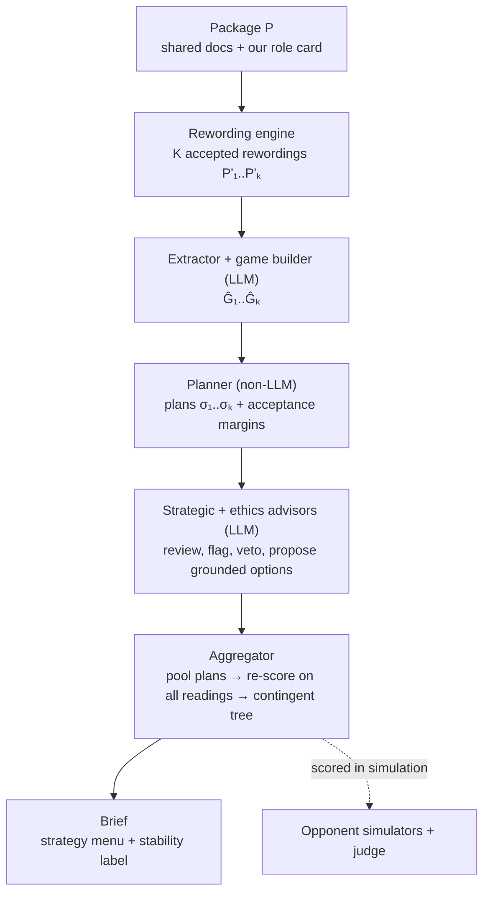

# Negotiation Advisor — Plan A: Rewording-Only Perturbation

A multi-agent system that helps a human team prepare for a **turn-based,
two-team, non-zero-sum negotiation** in humanitarian-crisis settings, and a
study of how **rewording the negotiation package** (same facts, different
words) changes the strategies the system suggests.

> **Status:** planning complete, implementation starting (Week 1 of 8, from
> 2026-10-20). COMPSCI 2822R final project. Owner: Vedant Sandhu.
>
> This README is the working plan. Edit it as decisions are made. Items marked
> **[DECIDE]** are still open; items marked **[ASSUMPTION]** are defaults we
> chose so work can start.

---

## Contents

1. [The idea in one minute](#1-the-idea-in-one-minute)
2. [Research question and hypotheses](#2-research-question-and-hypotheses)
3. [Scope and assumptions](#3-scope-and-assumptions)
4. [Formal model](#4-formal-model)
5. [From package to game](#5-from-package-to-game)
6. [Rewording engine](#6-rewording-engine)
7. [System components](#7-system-components)
8. [Formal results](#8-formal-results)
9. [Evaluation](#9-evaluation)
10. [Train, validate, test](#10-train-validate-test)
11. [Repository layout and setup](#11-repository-layout-and-setup)
12. [Timeline](#12-timeline)
13. [Risks](#13-risks)
14. [What Plan A can and cannot claim](#14-what-plan-a-can-and-cannot-claim)
15. [After Plan A: Plan B](#15-after-plan-a-plan-b)
16. [Open decisions](#16-open-decisions)
17. [References](#17-references)

---

## 1. The idea in one minute

Both teams get the same shared package plus their own private role card. We
play one side and want the best outcome for our side. We do not assume the
other side has to lose for us to win.

The system works in three layers:

1. **LLMs turn text into a game.** The package is converted into a
   *commitment game* in the style of Benac et al. (2026): the actions each side
   can commit to, the goals those actions satisfy, and a goal-utility matrix
   `G` that says how much each side values each goal. Our column of `G` comes
   from our role card. The opponent's column is **estimated**, because we only
   partly know what they value.
2. **A non-LLM planner solves the game.** It computes which commitments to
   trade, in what order over the turns, and when to walk away.
3. **LLM advisors check and explain the plan.** A strategic advisor reviews it
   for things the game leaves out, an ethics advisor can flag or veto moves,
   and the result is written up as a one-page brief with a short menu of
   options.

**The perturbation we study is rewording only.** We say the same facts in
different words. The meaning does not change, so the true game and the best
plan do not change either. **Any change in the advice is therefore an error
caused by wording.** This gives us a clean test that needs no ground-truth
labels: the right answer is always "no change".

**The readings also generate strategies.** Each rewording yields a slightly
different estimate of the game, so the `K` readings act as `K` plausible
versions of the same negotiation. We:
- pool the best plan from every reading and keep those that score well
  across *all* readings;
- where readings disagree about what the opponent values, build a
  **contingent strategy**: a probing first offer, then a different plan
  depending on whether they accept.

This adds strategies without adding information, so it stays within the
rewording-only scope.

> **Why rewording first?** It fits the ~8-week timeline, it needs no
> ground truth on real packages, and every piece of it is reused later when we
> move to fact-changing (counterfactual) perturbations in Plan B (§15).



---

## 2. Research question and hypotheses

> **When a package's facts are reworded without changing their meaning,**
> **(a)** how much do the suggested strategies change, at which pipeline stage
> does the change enter, and does it track the embedding-space distance
> between the original and reworded facts?
> **(b)** Does aggregating over rewordings produce better and more stable
> strategies than a single reading at equal compute, and better than simply
> resampling the same text?
> **(c)** Does pooling plans across rewordings give a larger menu of robust,
> near-optimal strategies, including contingent ones, than resampling or
> sampling the opponent's values directly?

| ID | Hypothesis | Why we expect it |
|---|---|---|
| **H1** Brittleness exists | A single-reading pipeline changes its plan under accepted rewordings at a non-trivial rate. | LLM outputs are known to shift under meaning-preserving prompt changes (Sclar et al. 2024; Mizrahi et al. 2024). |
| **H2** Wording, not just noise | Brittleness under meaning-preserving rewording is comparable to random surface noise at matched embedding distance, i.e. the system reacts to surface form. | If this holds, the system is reacting to form rather than content. |
| **H3** Where it enters | Most plan changes come from errors in the opponent's column `Ĝ_opp` near acceptance thresholds. | Predicted by Props. A3–A4 (§8): errors in our own column have bounded cost; errors in theirs can flip an accept into a reject. |
| **H4** Aggregation helps | Rewording × K lowers regret and instability versus a single reading **and** versus same-text resampling × K. | Prop. A2: averaging removes variance, and it removes more when the readings are less correlated. |
| **H5** The planner helps | The planner pipeline is less brittle than an LLM-only advisor. | The planner is deterministic given `Ĝ`, so wording can only enter through the game, not through free-form reasoning. |
| **H6** A better menu | Pooling across rewordings yields more distinct near-optimal plans than same-text resampling (B2) or sampling `G_opp` directly (B9), with equal or better true utility. When readings split into opponent types, the contingent strategy beats the best single plan. | Different readings misread different parts of the game, so their plans cover more of the good deals; re-scoring across readings filters out plans that only win on one misreading. |

A negative result on any of these is still reportable. For example, if
rewording helps no more than resampling (H4 false), that is a useful finding
for anyone building these tools.

---

## 3. Scope and assumptions

### 3.1 Non-zero-sum **[ASSUMPTION]**
The two teams' payoffs do not add up to a constant: some outcomes are better
or worse for both. Our objective is **our own utility**. Joint value is
tracked as a secondary metric.

**[DECIDE]** Should we also assume a positive zone of agreement, i.e. some
outcome `C` that both sides prefer to no deal?

### 3.2 What counts as a rewording **[ASSUMPTION]**
A rewording changes the words, not the meaning.

| Operator | Unit | What changes |
|---|---|---|
| `paraphrase_fact` | one atomic fact | wording of that fact |
| `paraphrase_doc` | one source document | wording of the whole document |
| `reorder` | package | order of documents or facts |
| `register` | document | tone or register (formal ↔ plain), same content |

**Excluded**, because they change content rather than wording:
- inserting distractor facts or dropping facts;
- gain/loss reframing strong enough to fail the entailment test;
- every counterfactual shift (that is Plan B).

A rewording is **accepted** only if all three checks pass:
1. cosine similarity to the original is at least `τ`;
2. NLI entailment holds in **both** directions;
3. hard facts (numbers, names, red lines) are unchanged.

A 5% sample of accepted rewordings is checked by a human.

### 3.3 Game model, adopted from Benac et al. (2026)
Our professor's benchmark defines the game we use. We keep most of its
assumptions and change two.

| # | Benac assumption | Our use | Why |
|---|---|---|---|
| A1 | Binding commitments; they can be added, never withdrawn | **Adopted** | Matches how deals are built up in the exercise. |
| A2 | Goals need specific commitments; `G` gives each player's value per goal; goals are linear or all-or-nothing | **Adopted**; `G` is built from text (§5) | Gives us an exact, scoreable objective. |
| A3 | Bilateral turns: propose, then accept or reject | **Adopted**; proposer alternates. Non-players (mayor, militia, NGOs) enter as goals or constraints | The exercise is two teams taking turns. |
| A4 | Everyone knows everyone's utilities | **Relaxed**: `G_us` from our role card; `G_opp` estimated as a distribution `π(G_opp)` | Each team has a private role card, so we only partly know the opponent. |
| A5 | Agents are planners or RL methods | **Hybrid**: the planner optimises; LLMs build the game, review and explain | In Benac et al., simple planners beat learned RL policies; LLMs are needed to read the text. |

---

## 4. Formal model

**Package.** `P = (D, R_us)`: the shared documents `D` and our private role
card `R_us`.

**Rewording set.** `[P]` is the set of all accepted rewordings of `P` (§3.2).
`ν` is the sampling distribution over `[P]` induced by our operators.

**Assumption M (meaning is preserved).** Every `P′ ∈ [P]` describes the same
true game `𝔊* = (A, goals, 𝒞, types, G*)`. This holds only as well as the
acceptance filter does. If it fails, our measured brittleness is an **upper
bound** on the true brittleness.

**Game** (Benac form, two players):

- **Commitment state** `C ∈ {0,1}^(|A_us| + |A_opp|)`. It starts at `C⁰ = 0`
  (no deal), and entries only go from 0 to 1.
- **Goal satisfaction.** Each goal `g` requires a set of commitments `𝒞_g`.

```math
S_g(C) = \frac{|\mathcal{C}_g \cap C|}{|\mathcal{C}_g|} \;\; \text{(linear)}, \qquad
S_g(C) = \mathbf{1}[\mathcal{C}_g \subseteq C] \;\; \text{(all-or-nothing)}
```

  Both are non-decreasing in `C`.
- **Rewards.**

```math
r_i(C) = \sum_g G_{g,i}\, S_g(C)
```

- **Protocol.** `T` turns; the proposer alternates; at most `k` new
  commitments per side per offer; the responder accepts or rejects; either
  side may walk away.
- **Acceptance model.** The opponent accepts a move `C → C′` if and only if
  its estimated value does not fall (the incentive-compatibility constraint of
  Zhu et al. 2025):

```math
\sum_g \hat G_{g,\mathrm{opp}}\, \Delta S_g \;\ge\; 0, \qquad \Delta S_g = S_g(C') - S_g(C)
```

**The pipeline as a map.**
- `Ĝ(P′)` is the game built from text `P′`.
- `σ(Ĝ)` is the planner's output, which is deterministic.
- `adv(P′, Ĝ, σ)` is the advisors' output, which is stochastic.

**Plan** `σ`: ordered offers, expected responses, fall-backs, a walk-away
point, ethics flags, and a margin for each offer (Prop. A4).

**Objective.** The plan is scored on the **true** game, normalised to `[0, 1]`:

```math
U(\sigma) = r_{\mathrm{us}}(\sigma;\, \mathfrak{G}^*)
```

**Brittleness** is any dependence of `σ` or `U(σ)` on which `P′ ∈ [P]` was
read.

**Cross-reading score.** When the true game is unknown, a plan is scored on
every reading's game. The worst case `min_k r_us(σ; Ĝ_k)` is reported
alongside it.

```math
\bar U(\sigma) = \frac{1}{K}\sum_{k=1}^{K} r_{\mathrm{us}}(\sigma;\, \hat G_k)
```

On generated games we *select* with `Ū` and *report* the true `U`.

**Opponent types from readings.** Cluster the `K` estimates `Ĝ_opp,k` into
`m ≤ 3` types `θ_1..θ_m`, with weights `w_j` equal to the share of readings
in each type. A **contingent strategy** `τ` is a short decision tree: an
opening offer, then one branch per response, each branch planned for the
types consistent with that response. Its value is:

```math
V(\tau) = \sum_{j=1}^{m} w_j\, r_{\mathrm{us}}(\tau;\, \theta_j)
```

---

## 5. From package to game

| Step | Input → output | Notes |
|---|---|---|
| 0 Ingest | PDF/docx → items with verified quotes | reuse `../pipeline/` |
| 1 Atomise | items → facts `F`, each with quote, type and relevance | new |
| 2 Players | `us`, `opp`; everyone else → stakeholders | stakeholders become goals or constraints |
| 3 Actions | `F` → `A_us`, `A_opp` | concrete commitments with owner and quote; about 8 or fewer per side |
| 4 Goals | `F` → goals with `𝒞_g` and type | costs become goals with negative value |
| 5 `G_us` | role card → our column | repeated elicitation, take the median |
| 6 `π(G_opp)` | shared docs + role-card statements → distribution | spread comes from repeated elicitation |
| 7 BATNA | `r(C⁰)` + outside options | |
| 8 Checks | Benac stability metrics, human check, round trip on generated games | |

**Where rewording enters.** Either before step 1 (the whole package is
reworded) or between steps 1 and 3 (individual facts are reworded). We run
both. The fact-level version lets us attribute changes to individual facts.

### Worked sketch: Simulation 2 (we are the Camp Commander, the opponent is FWB)

*The numbers are illustrative, not the real role-card values.*

**Actions.**
- Camp Commander: `a1` independent FWB distribution staff · `a2` FWB hires
  local labourers · `a3` stop giving refugee rations to guards · `a4`
  MASHA/monitor access · `a5` guard conduct code + complaint channel.
- FWB: `b1` ongoing food deliveries · `b2` separate ration / cash-for-work for
  guards · `b3` fuel and sanitation support · `b4` joint distribution with the
  Commander's office · `b5` no public criticism while the deal holds.

| Goal | `𝒞_g` (type) | G_us | G_opp |
|---|---|---|---|
| g1 Refugees adequately fed | {b1, a3} (all-or-nothing) | 2 | 10 |
| g2 Guards fed and loyal | {b2} | 9 | −1 |
| g3 Commander visibly in charge | {b4} | 6 | −1 |
| g4 Independent outsiders in camp | {a1, a2} (linear) | −5 | 4 |
| g5 No unrest / international incident | {b1, b2, a5} (linear) | 7 | 5 |
| g6 Aid independent, not diverted | {a1, a3, a4} (linear) | −3 | 9 |
| g7 Camp infrastructure works | {b3} | 5 | 0 |
| g8 FWB spends beyond food mandate | {b2, b3} (linear) | 0 | −3 |

With 10 actions there are 1,024 states, so exact search is cheap. The
trade-off table surfaces the logroll `b2 ↔ a3`: the guards are fed
separately, and the diversion of refugee food ends. This is exactly the kind
of non-zero-sum trade the system is meant to find.

---

## 6. Rewording engine

1. Embed every fact and document with one open sentence encoder
   (MTEB-class).
2. Generate `K` rewordings per unit with an LLM, asking for several
   "distances" (light, moderate, heavy) so that the embedding distance
   `d_emb` covers a range.
3. Accept or reject each one using the checks in §3.2, and log rejection
   rates per operator.
4. Record `d_emb(P, P′)`, the cosine distance averaged over changed units.
5. **Random-noise control (for H2).** Character- and word-level noise at
   matched `d_emb` that is *not* checked for meaning. This separates "the
   system reacts to wording" from "the system reacts to any surface change".

---

## 7. System components

| Component | Type | Job |
|---|---|---|
| Extractor + atomiser | LLM | §5 steps 0–1: package → atomic facts with source quotes. |
| Rewording engine | LLM + embeddings | §6: produce and filter rewordings. |
| Game builder | LLM | §5 steps 2–8: facts → actions, goals, `G_us`, `π(G_opp)`, BATNA. |
| Planner | non-LLM | Exact search over commitment sequences for small games; MCTS with Benac value estimates for larger ones. Outputs the plan, the trade-off table, and the margin of every offer (Prop. A4). |
| Strategic advisor | LLM | Reviews the plan for things `G` leaves out (relationships, reputation, context). Writes the brief. |
| Ethics advisor | LLM | Flags moves against humanitarian principles and do-no-harm; can veto. |
| Aggregator | non-LLM | Combines the `K` readings and generates the strategy menu (below). |
| Opponent simulators + executor | planner and LLM | Planner opponents and LLM opponents from at least 2 model families play the plan turn by turn, for scoring. |
| Judge | code, then LLM | Scores programmatically from the true `G` where we have it. For unscored packs, an LLM judge from a different model family than the advisors, run with the order swapped and calibrated against human ratings. |

**How the aggregator builds the strategy menu.**

1. **Averaged game.** Average `Ĝ` over rewordings (when their structure
   matches), then plan once. This plan is always a candidate.
2. **Pool.** Add each reading's own best plan `σ_k`.
3. **Structural alternatives.** Where readings disagree on the actions or on
   what a goal requires, plan on each version. Label the plan with the
   ambiguous passage, e.g. *"if 'joint distribution' means co-signing
   manifests rather than co-staffing, a cheaper deal exists."*
4. **Contingent strategy.** If the readings' `Ĝ_opp` split into more than one
   opponent type (§4), the planner builds the decision tree `τ`: a probing
   opening offer whose accept or reject tells us which type we face, then
   the best plan for that type.
5. **Advisor ideas.** Advisors reading different rewordings propose extra
   options (sequencing, packaging, side guarantees). A new action is
   accepted only with a quote from the package. It then goes back through
   the game builder and is scored by the planner. Ideas that need new facts
   belong to Plan B.
6. **Re-score.** Score every candidate on every reading (`Ū` and worst
   case). Drop candidates that only win on their own reading.
7. **Menu.** Choose 3–5 candidates that are as different as possible while
   each scores at least `α · max Ū` (constrained diversity, Braun et al.
   2026). Add the contingent tree if it beats the best single plan.
8. **Fresh re-scoring.** Recompute the menu's scores on a fresh set of
   rewordings and episodes before showing or reporting them (Prop. A5).

Each plan also gets a **stability label**: "stable" if Corollary A4′'s
certificate holds for all `K` readings, with the agreement rate across
readings.

> **Why a menu and not one answer?** Frontline humanitarian negotiators
> said they want tools that help them explore options and their risks, not
> tools that tell them what to do (Ma et al. 2024, 2025).

---

## 8. Formal results

Notation: `ν` is the distribution over rewordings `[P]`; `Ĝ(P′)` is the game
built from rewording `P′`; `G*` is the true matrix; `U ∈ [0, 1]`.

All proofs are short. Each result is paired with what we use it for.

### Prop. A1: rewording spread lower-bounds extraction error

```math
\mathbb{E}_\nu \lVert \hat G(P') - G^* \rVert^2
= \lVert \mathbb{E}_\nu \hat G - G^* \rVert^2 + \mathbb{E}_\nu \lVert \hat G - \mathbb{E}_\nu \hat G \rVert^2
\;\ge\; \mathbb{E}_\nu \lVert \hat G - \mathbb{E}_\nu \hat G \rVert^2
```

*Proof.* Expand around `E_ν Ĝ`; the cross term has expectation zero. ∎

**Use.** On real packs there is no gold `G`. The spread across rewordings can
be measured, and it is a guaranteed lower bound on the extraction error.

### Prop. A2: when aggregating over rewordings helps

Let `Ḡ_K = (1/K) Σ_k Ĝ(P′_k)`. If per-entry errors have common variance `s²`
and pairwise correlation `ρ`, then, per entry and summed over entries:

```math
\mathbb{E}\lVert \bar G_K - G^* \rVert^2 = \lVert \text{bias} \rVert^2 + s^2 \left(\rho + \frac{1-\rho}{K}\right)
```

*Proof.* The variance of the mean of `K` equicorrelated variables is
`(1/K²)(K s² + K(K−1) ρ s²)`. ∎

**Use.** Aggregation removes wording variance, not bias. With equal `K` and
equal bias, rewording beats same-text resampling **if and only if**
`ρ_reword < ρ_resample`. This is the exact form of H4, and `ρ` is estimated
from data.

### Prop. A3: errors in our own column have bounded cost

For every state `C`:

```math
\lvert r_{\mathrm{us}}(C; G_{\mathrm{us}}) - r_{\mathrm{us}}(C; G'_{\mathrm{us}}) \rvert \le \lVert G_{\mathrm{us}} - G'_{\mathrm{us}} \rVert_1 =: \varepsilon
```

*Proof.* `S_g ∈ [0, 1]` and the triangle inequality. ∎

*Corollary.* If the set of plans the opponent is predicted to accept is the
same under both columns, the plan chosen under `G′_us` loses at most `2ε` on
the true values:
`r(σ′) ≥ r′(σ′) − ε ≥ r′(σ*) − ε ≥ r(σ*) − 2ε`. ∎

**Use.** Misreading our own values costs little. The real risk is in the
opponent's column (Prop. A4).

### Prop. A4: acceptance margin

For an offer `C → C′` with margin `m = Σ_g G_{g,opp} ΔS_g > 0`, the
acceptance decision is unchanged for every error `δ` in the opponent's column
with

```math
\lVert \delta \rVert_1 < \frac{m}{\lVert \Delta S \rVert_\infty}
```

and the bound is tight.

*Proof.* By Hölder, `|δ · ΔS| ≤ ‖δ‖₁ ‖ΔS‖_∞`. For tightness, put all of `δ`
on `argmax_g |ΔS_g|` with the opposite sign. ∎

### Corollary A4′: plan stability certificate

For a rewording, let `ε_us = ‖ΔĜ_us‖₁`, `ε_opp = ‖ΔĜ_opp‖₁`, and let `m_min`
be the smallest value of `m / ‖ΔS‖_∞` over the offers in the planner's
search. If

1. the goals and actions are unchanged,
2. `ε_opp < m_min`, and
3. the chosen plan beats the runner-up by more than `2 ε_us`,

then the planner returns the same plan.

*Proof.* By A4 the set of feasible plans is unchanged; by A3 the argmax is
unchanged. ∎

**Use.** A deterministic, checkable statement that the plan is stable, shown
in the brief.
**Limit.** It says nothing when a rewording changes the game's *structure*
(new or missing goals or actions). Structure stability is measured separately
with the Benac metrics.

### Prop. A5: winner's curse

With noisy scores `Ŝ_i = S_i + ε_i`, where `ε_i` is σ-sub-Gaussian, over `N`
candidates and `î = argmax Ŝ_i`:

```math
\mathbb{E}\big[\hat S_{\hat\imath} - S_{\hat\imath}\big] \le \sigma\sqrt{2\ln N}
```

**Use.** Picking the best of many noisy candidates inflates its score. Any
selected plan is re-scored on fresh episodes before we report it.

### Prop. A6: sample size

For scores in `[0, 1]`, evaluating each strategy on

```math
n \ge \frac{2\ln(4/\delta)}{\Delta^2}
```

episodes separates a true gap `Δ` with probability `1 − δ` (Hoeffding plus a
union bound). For `Δ = 0.1` and `δ = 0.05`, `n ≈ 876`. Paired designs need
fewer.

### Remark A7: pooling and contingency never lower the selection score

- The pool contains the single-reading and averaged-game plans, so the best
  `Ū` in the pool is at least as high as theirs.
- A plan that ignores the opponent's response is a contingent tree whose
  branches are identical, so the best tree's `V` is at least the best plan's.

**Use and limit.** Both statements are about scores on *estimated* games,
and a larger pool increases the winner's-curse bias (A5 with a larger `N`).
So we claim a gain only after fresh re-scoring, and only on the true `U` of
generated games.

### Measure (not a theorem): embedding effect

```math
\hat L = \max_{P'} \frac{D(\sigma(P), \sigma(P'))}{d_{\mathrm{emb}}(P, P')}, \qquad \operatorname{corr}(D,\, d_{\mathrm{emb}})
```

`D` is the distance between strategies. The ideal is `D ≡ 0`. We report this
separately for each stage: game, plan and advisor.

---

## 9. Evaluation

### 9.1 Studies
- **S1 Brittleness by stage.** For each pack or game and `K` rewordings,
  measure the change at each stage:
  - game structure (Benac similarity);
  - `G` entries (L1 distance);
  - plan (structured diff);
  - advisor output (archetype flip, rationale distance).

  An advisor-only variant fixes `Ĝ` and rewords only the advisor's input.
- **S2 Embedding effect.** Curves of `D` against `d_emb`, the estimate `L̂`,
  and rewording versus the random-noise control at matched `d_emb`.
- **S3 Aggregation.** Regret on generated games, where the true `G` is known,
  for three conditions: a single reading, same-text resampling × K, and
  rewording × K. Estimate `ρ` (Prop. A2).
- **S4 Certificate validity.** How often Corollary A4′ holds, and whether
  certified plans really are stable on fresh rewordings.
- **S5 Strategy menu.** On generated games, compare rewording × K with B2
  and B9 at equal compute:
  - the number of distinct plans with true `U ≥ α · U*`;
  - their coverage of the Pareto-efficient deals;
  - the true `U` of the best menu item and of the contingent tree.

### 9.2 Baselines (all matched on compute)

| ID | Condition |
|---|---|
| B0 | Single LLM, zero-shot strategy |
| B1 | B0 + chain-of-thought |
| B2 | Same-text resampling × K, aggregated (**main control**) |
| B3 | Multi-agent, single reading |
| B4 | Random-noise perturbation × K at matched `d_emb` |
| B7 | Planner on a single-reading `Ĝ`, no LLM advisors |
| B8 | LLM advisors only, no planner |
| B9 | Planner over `K` samples of `G_opp` drawn from the single-reading `π(G_opp)`, with the same pooling and contingent tree; no rewording (**hardest control**) |
| **A** | Rewording × K + planner + advisors + aggregator |

> **Why B9 matters.** If rewording helps only because it widens our estimate
> of the opponent's values, then sampling those values directly should do
> just as well. Rewording earns credit for H4 and H6 only if it beats B9,
> for example by also catching misread game structure.

IDs are kept from the original combined plan so results stay comparable. B5
and B6 belong to Plan B.

### 9.3 Metrics
- **Stability:** plan-change rate; archetype flip rate; `L̂`; L1 distance in
  `G`; Benac goal and action similarity; certificate coverage; ethics-flag
  stability.
- **Outcomes:** our utility and regret on generated games; agreement rate;
  walk-aways below BATNA (should be 0).
- **Menu:** number of distinct plans within `α` of the best; coverage of
  Pareto-efficient deals; gain of the contingent tree over the best single
  plan.

### 9.4 Statistics
- Paired designs.
- Mixed-effects models: condition as a fixed effect; pack and opponent as
  random effects.
- Bootstrap 95% confidence intervals.
- Holm–Bonferroni correction across hypotheses.
- At least 3 seeds.

---

## 10. Train, validate, test

The live course negotiation is the **test**. Everything before it happens
offline with no time limit.

| Split | Data | Time limit |
|---|---|---|
| Train | Generated Benac games rendered as text; Simulation 1 | none |
| Validate | Held-out generated games; Simulation 2 | none |
| Test | Live exercise package, unseen | 12 min prep (brief within 6 min), then 12–15 min negotiation |

**Frozen before the test:**
- the rewording operators and thresholds;
- the game builder prompts;
- the aggregation rule and `K`;
- the menu settings (`α`, number of opponent types `m`, tree depth);
- the advisor and ethics prompts.

Nothing is tuned on the test package. The live result is reported as a case
study, separately from the validation numbers.

---

## 11. Repository layout and setup

> Planned layout; folders are created as the timeline (§12) reaches them.

```
Final Build/
├── README.md                  ← this plan
├── PLAN_A_REWORDING.md        ← compact working copy of Plan A
├── PLAN_B_COUNTERFACTUAL.md   ← the follow-on plan (§15)
├── PLAN_COMPARISON.md         ← effort and burden-of-proof comparison
├── PROJECT_PLAN.md            ← earlier combined plan (kept for reference)
├── requirements.txt
├── .env.example               ← API keys (never commit .env)
├── configs/
│   ├── default.yaml           ← models, budgets, seeds, thresholds
│   └── experiments/*.yaml     ← one file per baseline / study
├── data/
│   ├── packs/                 ← course packs (Simulation 1, Simulation 2)
│   ├── gold/                  ← human annotations
│   └── scored_games/          ← games with true G (hidden from advisors)
├── negotiator/
│   ├── schemas.py             ← Fact, Game, Plan, Transcript, Score
│   ├── llm.py                 ← provider-agnostic client + prompt-hash cache
│   ├── extract/               ← wraps ../pipeline + atomiser
│   ├── reword/                ← embedder, operators, acceptance filter, noise control
│   ├── game/                  ← commitment game, text→game builder, game→text renderer
│   ├── planner/               ← exact search, MCTS, trade-off table, margins, certificate, contingent tree
│   ├── agents/                ← advisors, ethics, opponents, executor, judge, aggregator
│   ├── eval/                  ← metrics, statistics
│   └── prompts/               ← all prompts as .md files
├── scripts/                   ← command-line entry points
├── runs/                      ← outputs, one folder per run (gitignored)
└── tests/
```

**Setup (once code exists):**

```bash
cd "Final Build"
python3 -m venv .venv && source .venv/bin/activate
pip install -r requirements.txt
cp .env.example .env    # add ANTHROPIC_API_KEY and a key for the judge's provider
```

**Planned commands:**

```bash
python scripts/extract.py  --pack data/packs/sim2 --side "Camp Commander"
python scripts/reword.py   --facts runs/<id>/facts.json --k 16
python scripts/advise.py   --config configs/experiments/a.yaml
python scripts/evaluate.py --runs runs/<id1> runs/<id2> --report
```

---

## 12. Timeline

About 8 weeks from 2026-10-20. Each week ends with a check that must pass
before moving on.

| Week | Deliverable | Check |
|---|---|---|
| 1 | Repo skeleton, schemas, LLM client + cache, extractor + atomiser | Simulations 1 and 2 extract end to end; quotes 100% verified |
| 2 | Game builder; Simulation 2 game; Benac generator + game→text renderer | A rendered package round-trips to the same `G` |
| 3 | Planner (exact) + trade-off table + margins; rewording engine + filter | At least 95% of accepted rewordings judged meaning-preserving by a human |
| 4 | Advisors, aggregator with pooling + contingent tree, opponents, judge | A full episode runs end to end; the contingent tree matches brute force on a small game |
| 5 | Studies S1 + S2 | Brittleness-by-stage table; `D` vs `d_emb` plots |
| 6 | Studies S3 + S4 + S5 | Aggregation vs resampling with CIs; certificate coverage; menu vs B2 and B9 |
| 7 | Freeze + exercise pipeline (brief within 6 min) | 10 out of 10 timed dry runs succeed |
| 8 | Write-up | Headline numbers reproduce |

---

## 13. Risks

| Risk | Mitigation |
|---|---|
| Rewordings secretly change meaning (Assumption M fails) | Two-way NLI + frozen hard facts + 5% human check; report brittleness as an upper bound |
| Rewording changes the game's *structure* (new or missing goals) | Report structure stability separately; A4′ applies only when structure matches |
| Aggregation helps only as much as resampling | That is a valid finding (H4 false); report it |
| A larger candidate pool inflates scores (winner's curse) | Select on `Ū`; report on fresh rewordings and episodes, and on true `U` (A5, A7) |
| The probing offer is binding and costs value | The planner prices it in: the tree is used only if `V(τ)` beats the best single plan |
| Judge bias | Programmatic scoring on generated games; judge from a different model family |
| Cost | Prompt-hash cache; small-`K` pilots first |

---

## 14. What Plan A can and cannot claim

**Can:**
- quantify wording brittleness at each stage of the pipeline;
- give a provable stability certificate in `G` space;
- show whether aggregating over rewordings beats resampling;
- produce a larger menu of robust plans, including contingent strategies, for
  the package as written.

**Cannot:**
- say whether the advice responds *correctly* when facts really change;
- discover strategies for situations that are not in the package.

New plans in Plan A come from searching across readings, not from new
information. Strategies for changed facts are Plan B.

---

## 15. After Plan A: Plan B

`PLAN_B_COUNTERFACTUAL.md` extends this work to perturbations that change
the facts by a controlled amount (for example, the opponent's BATNA gets
stronger), where the *right* answer is a specific change in the plan.
Everything in Plan A is reused:
- the rewording engine becomes Plan B's wording control;
- Props. A3–A4 become Plan B's bounded/unbounded-column result.

The recommended order is to finish Plan A, then add Plan B's provable shifts
first (goal values, BATNAs, number of turns), and only then the parts that
need concept directions, steered decoding or self-play. `PLAN_COMPARISON.md`
gives the effort and burden-of-proof comparison.

---

## 16. Open decisions

- **[DECIDE]** Is a deal preferred over no deal? Modelled as a parameter
  `deal_bonus`; results are reported for `{0, small, large}`.
- **[DECIDE]** Is the package available before prep starts? We assume not.
- **[DECIDE]** Is live AI use allowed during the negotiation?
- **[DECIDE]** Which side do we play in each pack?
- **[DECIDE]** Can we get access to the Benac code (anonymous review link)?
- **[DECIDE]** Do we assume a positive zone of agreement (§3.1)?

---

## 17. References

**Negotiation analysis**
- Fisher, R., & Ury, W. (1981). *Getting to Yes.* Houghton Mifflin.
- Lax, D. A., & Sebenius, J. K. (1986). *The Manager as Negotiator.* Free Press.
- Raiffa, H. (1982). *The Art and Science of Negotiation.* Harvard University Press.

**Game model and planning**
- Benac, Raedler, Ma & Doshi-Velez (2026). *A Benchmark for Multi-Party
  Negotiation Games from Real Negotiation Data.*
  [arXiv:2603.14066](https://arxiv.org/abs/2603.14066). Our primary model and
  benchmark: the commitment game, the generator, the planners (Myopic, Upper
  and Lower value estimates), and the text-to-game pipeline with stability
  metrics (goal similarity 0.791, action similarity 0.960).
- Zhu, Wang, Subramanian & Poupart (2025). *Learning to Negotiate via
  Voluntary Commitment.* AISTATS. Commitment games with an
  incentive-compatibility constraint on proposals, which is the basis for our
  acceptance rule.
- Wu et al. (2024). *Minimally Modifying a Markov Game.* ICML. Finds the
  smallest payoff change that alters the equilibrium. We ask the inverse
  question (the smallest change to `G_opp` that flips an acceptance), which
  gives Prop. A4.
- Braun, Auddy & Toussaint (2026). *Trajectory First.* RLJ. Constrained
  diversity, used for the strategy menu.

**Robustness of LLM outputs**
- Sclar et al. (2024). *Quantifying Language Models' Sensitivity to Spurious
  Features in Prompt Design.* [arXiv:2310.11324](https://arxiv.org/abs/2310.11324).
- Mizrahi et al. (2024). *State of What Art? A Call for Multi-Prompt LLM
  Evaluation.* TACL.
- Ribeiro et al. (2020). *Beyond Accuracy: Behavioral Testing of NLP Models
  with CheckList.* ACL. [arXiv:2005.04118](https://arxiv.org/abs/2005.04118).
  Plan A is an invariance (INV) study in CheckList's terms.
- Wang et al. (2023). *Self-Consistency Improves Chain of Thought Reasoning
  in Language Models.* ICLR. [arXiv:2203.11171](https://arxiv.org/abs/2203.11171).
  Same-text resampling, our main control (B2).

**Users and judges**
- Ma et al. (2024). [arXiv:2405.20195](https://arxiv.org/abs/2405.20195), and
  Ma et al. (2025). *"ChatGPT, Don't Tell Me What to Do."*
  [arXiv:2410.09139](https://arxiv.org/abs/2410.09139). Frontline negotiators
  prefer option exploration to directives, which is why the output is a menu.
- Zheng et al. (2023). *Judging LLM-as-a-Judge with MT-Bench and Chatbot
  Arena.* [arXiv:2306.05685](https://arxiv.org/abs/2306.05685).
- Panickssery et al. (2024). *LLM Evaluators Recognize and Favor Their Own
  Generations.* [arXiv:2404.13076](https://arxiv.org/abs/2404.13076).

The longer literature review (MARL, PSRO, automated negotiation agents, and
others) is in `PROJECT_PLAN.md` §2.
